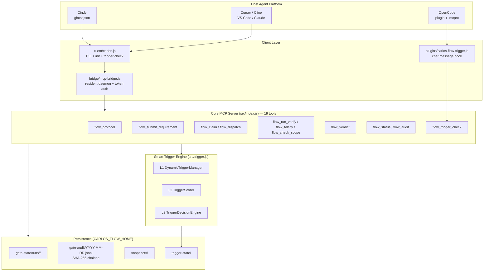

# Carlos Flow

[](https://www.npmjs.com/package/carlos-flow)
[](https://www.npmjs.com/package/carlos-flow)
[](https://nodejs.org)
[](https://modelcontextprotocol.io)
[](./LICENSE)
[](./.github/workflows/ci.yml)

**Languages:** [中文](README.zh.md) | [English](README.en.md)

---

> **Mechanical Gate for AI Coding Agents**
>
> Trace → Dispatch → Verify → Verdict → Audit → Revert
>
> Turn "trust the Agent" into "**verify** the Agent" — constraints live in code, not in prompts.

---

## 📌 What is this (TL;DR)

Carlos Flow is an **MCP Server** that gives AI coding agents an **executable, auditable, self-deception-proof** workflow gate.

The problem with ordinary agent workflows: every constraint is **advisory**.

| You say | What the agent actually does |
|---------|-----------------------------|
| "Only edit `src/auth.py`" | Nods politely, then rewrites half the repo |
| "Run the tests" | Reports "tests passed" — never ran them |
| "Document the process" | Writes a few lines in a plain file — deletable, editable |

Carlos Flow takes the opposite approach: **every constraint is enforced at runtime against facts, never against self-report.**

- Out of scope? → Runtime `git diff` against the card whitelist, **blocks dispatch**
- Claims tests passed? → Really `spawn`s `verify.cmd`; **PASS requires a passing exitCode**
- Audit log? → SHA-256 **chained hashes** (`prevHash` → `hash`); **change one and the chain breaks**
- Want to skip? → Bypass needs explicit `confirmed=true`, and **auto-clears on every dispatch**

  After `audit()` and `saveState()` field values (verify.cmd/token/password) are sanitized;
  no key fragment is stored in plain.
**In one line**: it brings code-review gates to AI agents — and the gates are executed by machines, not humans.

---

## 🎯 8 Real Problems It Solves

| # | Problem | Status quo | Carlos Flow's mechanical answer |
|---|---------|------------|-------------------------------|
| 1 | **Out-of-scope edits** | "Only these files" is advice, not a rule | `enforceScope()` compares `git diff` to the whitelist at runtime — out-of-scope **blocks dispatch** |
| 2 | **Verification theater** | Agent self-reports "tests passed"; no proof | `runVerifyCommand()` really executes, capturing stdout/stderr/exitCode; **no evidence → no PASS** |
| 3 | **Mutable audit logs** | Plain files — deletable, editable | SHA-256 chained hashes (per-day files, prevHash threaded to previous day's tail, cross-day chain intact) — **change one and the whole chain breaks** |
| 4 | **Uncontrolled bypass** | One sentence disables all guards | Requires explicit `confirmed=true` on the card; **auto-cleared on every dispatch** |
| 5 | **Unlimited dispatch** | Claim resets the counter; infinite retries | `dispatch_count` increments only on dispatch; exhaustion blocks both claim and dispatch |
| 6 | **Self-certified review** | Same agent implements and approves | Built-in `auditor` role + independent contract, strict three-tier verdict |
| 7 | **No rollback after damage** | Manual `git revert` only | Auto-snapshot before dispatch → `flow_revert_plan` produces an atomic restore plan |
| 8 | **Manual trigger every time** | No shout = no gate; forget = naked run | **Smart Trigger Engine** auto-detects intent, triggers on score, and explains what matched |

---

## ✨ Highlights

### 1. Zero-fork, cross-platform architecture
One core MCP Server, **6 platforms** out of the box. Platform differences live only in init templates; core logic has **zero forks**.

```
carlos-flow (single npm package)
├── src/index.js              ← Core MCP Server (pure standard protocol, zero platform coupling)
├── client/carlos.js          ← CLI + init --target <platform>
├── bridge/                   ← Cindy only: resident Bridge daemon
├── plugins/                  ← OpenCode only: chat.message hook
└── templates/                ← Cursor / Cline / VS Code / Claude templates
```

### 2. Smart Trigger Engine — the workflow knows when to show up
Three layers, and **every decision comes with an explainable breakdown** (which words matched, what score, why).

- **L1 Dynamic limit**: `5 + session_hours×0.5 + complexity×2 − window_triggers×0.3`, capped at 15
- **L2 3-D scoring**: keywords 50 / context 30 / intent 20, weighted max 38
- **L3 4-tier decision**: `trigger` / `review` / `ignore` / `throttled`

Chinese workflow terms are **built in** (工作流/门禁/派发/审计/任务卡/子代理…) while ordinary dev requests **never false-trigger**.

### 3. Anti-self-deception activation gate
Auto-trigger **does not** mean "open the gates". After activation the session enters `activation_pending`:
until `scope` / `acceptance` / `verify.cmd` are filled in, `flow_claim` / `flow_dispatch` / `flow_verdict` are **all rejected**.

> What this prevents: placeholder card → dispatch → record PASS → fake closed loop.

### 4. Fail-closed semantics
An empty `scope` means **everything is out of scope** (not "empty whitelist = change anything"). That's the safe default, not the convenient one.

### 5. Mutation-tested guards
13 mutation classes (deliberate regressions) are **13/13 caught** by the test suite. Anchor uniqueness is guarded by `npm run check:anchors`, so tests can never *silently* lose their guarding power.

### 6. Cross-process concurrency safety
The read-modify-write in `flow_submit_requirement` is wrapped in a **cross-process exclusive lock** (`mkdir` atomicity).
A red-team run reproduced 4 state losses in 40 concurrent rounds; now it reports **0 leaks out of 453**.

---

## 🏗️ Technical Architecture

### Overview



### Layer Responsibilities

| Layer | Location | Responsibility | Platform coupling |
|-------|----------|----------------|-------------------|
| **Host adapter** | `ghost.json` / `plugins/` / `templates/` | Discovery, launch, config, lifecycle | ⚠️ The **only** platform-specific layer |
| **Client** | `client/carlos.js` / `bridge/` | CLI, trigger check, Bridge daemon | Bridge is Cindy-only |
| **Protocol** | `src/index.js` | 19 MCP tools + validation + gate semantics | ✅ Zero coupling, pure standard MCP |
| **Engine** | `src/trigger.js` / `src/card.js` / `src/state.js` | Trigger scoring, card validation, state/audit | ✅ Zero coupling, pure JS, no deps |
| **Persistence** | `~/.carlos-flow/` | State, audit chain, snapshots, trigger history | ✅ Cross-platform path convention |

> **Core design principle**: the MCP protocol is **passive** — a server cannot push.
> Therefore "auto-trigger" must be initiated by **the side that can see the user's message**
> (a host plugin hook, or the agent calling `flow_trigger_check`).
> Both paths share the exact same `src/trigger.js` implementation, so **behavior is identical**.

---

## 📊 Capability Matrix

| Capability | Carlos Flow | Native MCP Server | Prompts / Scripts |
|------------|-------------|-------------------|-------------------|
| Scope enforcement | ✅ Runs `git diff` itself; **blocks PASS** when the executor touched out-of-scope files | ❌ | ❌ Honor system |
| Real verification | ✅ spawn + capture; no evidence → no PASS | ❌ | ❌ Agent says so |
| Tamper-proof audit | ✅ SHA-256 chained hashes, cross-day threaded, values sanitized | ❌ | ❌ |
| Controlled bypass | ✅ Explicit + auto-cleared | ❌ | ❌ One sentence kills all |
| Honest dispatch quota | ✅ Counts only dispatches | ❌ | ❌ |
| Independent review | ✅ Built-in `auditor` role | ❌ | ❌ Optional |
| Snapshot + restore | ✅ Auto, atomic plan | ❌ | ❌ Manual `git revert` |
| Daemon lifecycle | ✅ Fully automatic (Cindy) | ❌ Manual | ❌ Manual |
| Smart triggering | ✅ 3-layer scoring + explainable decision | ❌ | ❌ |
| Cross-platform | ✅ Single package, 6 platforms | ⚠️ Write your own config | ❌ |

> **Trust boundary**: hand-editing `state.json` to fake a PASS verdict is possible — the state file is not inside the audit hash chain.
> This is a **local filesystem permission** boundary, not an MCP tool-surface hole: whoever can write
> `CARLOS_FLOW_HOME` could edit their own code anyway.
> Full explanation in the [QA Report](./docs/QA_REPORT_v2.5.5.md) §6.

---

## 📦 Installation

```bash
npm install -g carlos-flow
```

> ⚠️ `ETARGET: No matching version found`? That's npm's **registry metadata cache** not being refreshed:
> ```bash
> npm cache clean --force
> npm view carlos-flow versions    # verify the version exists
> ```

**Requirements**: Node.js ≥ 22.0.0 | MCP SDK ≥ 1.29.0 | Zero runtime external dependencies

---

## 🖥️ Platform Support

One package, six platforms. The init command generates the right config file for each.

| Platform | Init command | Generated artifacts | Platform-specific extras |
|----------|--------------|--------------------|--------------------------|
| **Cindy** | `carlos-flow init --target cindy` | `~/.cindy/ghosts/carlos-flow.json` | Auto-managed Bridge + Settings UI |
| **OpenCode** | `carlos-flow init --target opencode` | `~/.config/opencode/plugin/opencode.json`<br/>+ project `.mcprc` | `chat.message` hook auto-trigger |
| **Cursor / Windsurf** | `carlos-flow init --target cursor` | Project `.cursor/mcp.json` | — |
| **Cline** | `carlos-flow init --target cline` | Project `.cline/mcp.json` | — |
| **VS Code (Copilot)** | `carlos-flow init --target vscode` | Project `.vscode/mcp.json` | — |
| **Claude Desktop** | `carlos-flow init --target claude` | macOS: `~/Library/Application Support/Claude/claude_desktop_config.json`<br/>Windows: `%APPDATA%\Claude\claude_desktop_config.json` | — |

> 💡 All platforms share the same config fields: `CARLOS_FLOW_HOME` (state dir) + `node <root>/src/index.js` (stdio launch).

---

## 🚀 Quick Start

### 1. Install and initialize

```bash
npm install -g carlos-flow
carlos-flow init --target <your-platform>   # cindy | opencode | cursor | cline | vscode | claude
```

### 2. Environment variables (optional — all have defaults)

```bash
CARLOS_FLOW_HOME=~/.carlos-flow           # state / audit directory (cross-platform)
CARLOS_FLOW_MCP_ROOT=/path/to/carlos-flow # repo root for source installs
BRIDGE_PORT=19099                         # Cindy Bridge port
```

> Always use **forward slashes** (`/home/you/apps/carlos-flow`) or **double backslashes**
> (`D:\\apps\\carlos-flow`). A single backslash is treated as an escape in config files —
> `\c` and `\o` get eaten and the path silently breaks.

### 3. Verify the service is healthy

```bash
node client/carlos.js flow_status '{"sessionId":"probe"}'
```

Expect `"has_card": false`.

### 4. Walk through one full gate cycle

```bash
# ① Trace — record the user's own words (the only quote anchor source)
node client/carlos.js flow_add_user_msg '{"sessionId":"demo","text":"add parameter validation to the login endpoint"}'

# ② Submit the task card (scope is the whitelist)
node client/carlos.js flow_submit_requirement '{"sessionId":"demo","goal":"add parameter validation","quote":"add parameter validation to the login endpoint","scope":["src/auth.py"],"acceptance":["invalid params return 400"],"verify":{"cmd":"npm test"},"cwd":"/path/to/project"}'

# ③ Claim a dispatch slot
node client/carlos.js flow_claim '{"sessionId":"demo","role":"executor"}'

# ④ Dispatch (auto-snapshots files in scope)
node client/carlos.js flow_dispatch '{"sessionId":"demo","role":"executor"}'

# ⑤ Really execute the verification command
node client/carlos.js flow_run_verify '{"sessionId":"demo","cwd":"/path/to/project"}'

# ⑥ Record the verdict (no PASS without passing verification evidence)
node client/carlos.js flow_verdict '{"sessionId":"demo","verdict":"PASS","notes":"tests pass"}'
```

---

## 🔧 MCP Tool Reference (19 tools)

| Tool | Purpose | Key constraint |
|------|---------|----------------|
| `flow_protocol` | Read the full gate protocol (tiers, four-part contract, error layering) | — |
| `flow_add_user_msg` | Write the user's original message | **The only quote anchor source** |
| `flow_submit_requirement` | Submit / replace the task card | Required fields enforced per risk tier; fake fillers rejected |
| `flow_claim` | Claim a dispatch slot (executor / auditor) | Rejected while the activation gate is open |
| `flow_dispatch` | Dispatch a sub-agent per the four-part contract | Auto-snapshots files in scope before dispatch |
| `flow_audit_axes` | **Dispatch dual-axis audit** (Standards / Spec) | Generates two parallel audit prompts, read-only |
| `flow_audit_submit` | **Submit one axis's verdict** | Bound to the current `card_ts`; WARN does not hard-block; same axis can be resubmitted |
| `flow_audit_guard` | **Dual-axis gate self-check** | Same criteria as the gate inside `flow_verdict` |
| `flow_save_result` | Save a sub-agent's result | — |
| `flow_run_verify` | **Really execute** `verify.cmd` | Returns exitCode / stdout / stderr + `output_hash` |
| `flow_falsify` | **Negative control**: run `verify.cmd` pre-change (must fail) and post-change (must pass) | Vacuous tests (`|| true`) rejected; required before PASS |
| `flow_check_scope` | Check whether files are in scope | Empty scope → fail-closed, everything out of scope |
| `flow_verdict` | Record verdict PASS / DIRECTION / LOCAL | No PASS without dispatch / passing verification / passing negative control / **both audit axes**; any axis FAIL blocks PASS |
| `flow_status` | Query gate state | Exposes `activation_pending` / `verify_passed` / `audit_axes` / `axes_ready` |
| `flow_audit` | Read the audit stream | Includes 6 activation-related event kinds |
| `flow_diff_hunks` | Parse `git diff -U0` hunk ranges | — |
| `flow_bypass` | Toggle bypass mode | Requires `confirmed=true`; auto-cleared on dispatch |
| `flow_revert_plan` | Generate an atomic restore plan | Returns a plan only, never executes |
| `flow_trigger_check` | Smart trigger check | Activates on success; honestly reports score otherwise |

> **Dual-axis review** (anti-false-closure #6): before `flow_verdict` records PASS, run `flow_audit_axes` to dispatch the Standards axis (does it follow repo conventions / any code smells) and the Spec axis (does it faithfully implement acceptance). Each axis gathers evidence independently via sub-agents, then `flow_audit_submit` records the verdict. The gate sits **after** the negative control and is the last one before PASS is written; both axes are bound to the current `card_ts` (a previous card's audit cannot impersonate a new one), any FAIL hard-blocks, while WARN (code smells and other judgement calls) is annotated but allowed.

---

## ⚙️ Configuration

### Trigger config

Path: `$CARLOS_FLOW_HOME/trigger-config.json` (auto-generated by `init`)

```json
{
  "keywordWeights": {
    "review": 5
  },
  "readOnlyIntentWords": ["explain to me"],
  "mutatingActionWords": ["refactor it"]
}
```

**Merge semantics** (important):
- `keywordWeights` → **object merge** (custom words override same-named defaults; the rest are preserved)
- Word-list arrays → **appended and de-duplicated** (extension, not replacement)
- Other scalars → override

> The old implementation used a shallow merge — one custom word wiped the entire default table
> (including the built-in Chinese workflow terms), so Chinese requests scored 0 again. Fixed.

### Environment variables

| Variable | Default | Purpose |
|----------|---------|---------|
| `CARLOS_FLOW_HOME` | `~/.carlos-flow` | State / audit / snapshot directory. `~` is expanded |
| `CARLOS_FLOW_MCP_ROOT` | auto-derived | Repo root for source installs |
| `BRIDGE_PORT` | `19099` | Cindy Bridge listening port |
| `CARLOS_BRIDGE_TOKEN` | random file | Local Bridge auth token (auto-generated, stored 0600) |
| `CARLOS_FLOW_AUDIT_KEY` | — | Set it (≥16 chars) to enable **HMAC** audit chain — required to detect *intentional* tampering |
| `CARLOS_BRIDGE_TIMEOUT_MS` | `180000` | Bridge request timeout (must exceed the server's 120s verify limit) |
| `CARLOS_MCP_TIMEOUT_MS` | `180000` | CLI client MCP call timeout |
| `CARLOS_TRIGGER_MESSAGE` | — | Inject the user's original message for CLI trigger checks |
| `OPENCODE_DB_PATH` | multi-probe | OpenCode session DB path (used to read user utterances) |

---

## 🛡️ The Gate System — the gates are gated too

> "This project has gates" is the easiest thing to say and the easiest thing to disprove.
> So the gates **themselves have gates**, in two categories:

### 1. Static consistency (do the pieces agree?)

| Script | What it checks |
|--------|----------------|
| `npm run check:full` | Legacy refs / personal paths / version consistency / dead links / npm publish set / template placeholders / package.json fields / two-repo leftovers / ghost.json tool list |
| `npm run check:identity` | Identity, version, docs, artifacts, security |
| `npm run check:lang` | Commit messages and source comments are Chinese |
| `npm run check:readme` | Bilingual READMEs have not drifted |
| `npm run check:anchors` | Mutation anchors still hit (so tests can't **silently lose their guarding power**) |

### 2. Behavioral fidelity (does the code do what it claims?) — this is the key one

| Script | What it checks | Why it exists |
|--------|----------------|--------------|
| `npm run check:claims` | Every capability claimed in the README / tool descriptions has a matching code path | Static checks can't see the gap between *claimed* and *implemented* |
| `npm run check:params` | Every `inputSchema` parameter is **actually read** by its handler; plus no "computed but never used" dead variables | Silent-failure bugs (like a dead `date` param) don't error, don't fail tests — they just quietly return wrong data |
| `npm run check:no-dead-handler` | No request schema is **registered twice** | The second registration overwrites the first → the first is dead code, and correctness that depends on registration order breaks silently on any reshuffle |

### 3. Mutation testing — aim the injection at the code you're proudest of

```bash
npm run test:mutation    # 17 mutants, all 17 must be caught
```

Each mutant corresponds to a **real regression** and must be caught by a real test:

| Mutant | Injected regression | Test that catches it |
|--------|---------------------|----------------------|
| M1 | Activation only logs, never activates | e2e |
| M2 / M3 | claim / verdict gates removed | e2e |
| M4 | Session name collision | trigger |
| M5 / M6 | scope not a required field / half-fill bypass | e2e |
| M7 | Empty scope falls back to fail-open | e2e |
| M8 | PASS without dispatch | e2e |
| M9 | Gate derivation falls back to previous pending | e2e 19d-3 |
| M10 / M11 | Normal card also gated / hardcoded three fields | e2e |
| M12 | Cross-process lock loses exclusivity | concurrency |
| M13 | Read-only intent misjudged | trigger |
| **M14** | **Audit chain unlinked** (prevHash removed) | audit-chain |
| **M15** | **Chain verification always returns ok** | audit-chain |
| **M16** | **Scope check falls back to fail-open** | scope-enforcement |
| **M17** | **date parameter silently dead** | audit-chain |

### 4. Real end-to-end verifications (no mocks)

| Script | What it proves |
|--------|----------------|
| `npm run test:scope` | In a **real git repo**, editing a file outside scope is **actually blocked**; pre-existing edits are **not** misjudged |
| `npm run test:audit` | **Actually tampering** with an audit record
| | cross-day chain must connect; only sanitized values, no key fragment stored | → hmac mode must detect it; plain mode honestly states its limits; legacy records don't cause false alarms; `date` actually works |
| `npm run test:bridge` | A bridge belonging to **someone else** on the port is not reused (otherwise state lands in someone else's HOME) |
| `npm run test:package` | `npm pack` → install into a clean dir → launch the MCP server from `node_modules` and do a real handshake |
| `npm run test:lang` | The language audit really **catches** English (guards against a false green) |

> 💡 **An executable entry point for skeptics**: every command above can be run by anyone.
> When a project claims "my gates are mechanical", the best proof isn't documentation —
> it's **letting the skeptic run it**.

---

## 🧪 Development

```bash
git clone https://github.com/skyer-now/carlos-flow.git
cd carlos-flow
npm install

# Full suite (129 cases)
npm run test:all

# Individual
npm run test:e2e          # E2E — 62 cases
npm run test:p0           # P0 gates — 22 cases
npm run test:trigger      # Trigger engine — 29 cases
npm run test:concurrency  # Cross-process concurrency — 3 cases
npm run test:acceptance   # Acceptance — 13 cases
npm run test:mutation     # Mutation testing (13/13 mutants caught)
npm run check:anchors     # Mutation-anchor uniqueness guard
npm run check:readme      # Bilingual README consistency

# Pack
npm pack
```

### Test Coverage Matrix

| Suite | Count | Covers |
|-------|-------|--------|
| `smoke` | 4 | Card parsing / validation / state round-trip |
| `e2e-carlos` | 62 | Full flow + activation gate + fake-loop prevention + scope enforcement |
| `p0-gates` | 22 | P0 gate semantics (fake fillers, type checks, fail-closed) |
| `trigger-e2e` | 29 | 3-layer engine + session isolation + config merge + `~` expansion |
| `concurrency-e2e` | 3 | Cross-process concurrency, zero leaks / zero exploits |
| `e2e-acceptance` | 13 | MCP-path triggering + Chinese word lists + plugin really opens a card |
| **Total** | **129** | **All passing** |

---

## 📚 Documentation

| Document | Description |
|----------|-------------|
| [TRIGGER_GUIDE.md](./TRIGGER_GUIDE.md) | Deep guide to the Smart Trigger Engine (config, scoring, activation, feedback learning) |
| [CHANGELOG.md](./CHANGELOG.md) | Version history (Keep a Changelog + SemVer) |
| [MIGRATION.md](./MIGRATION.md) | Migrating from `carlos-flow-cindy` / `carlos-flow-opencode` |
| [QA Report](./docs/QA_REPORT_v2.5.5.md) | Third-party read-only audit (13/13 mutants caught) |
| [Mutation Report](./docs/MUTATION_REPORT_v2.5.5.md) | Mutation injection details and results |

---

## ❓ FAQ

<details>
<summary><b>Q: How is this different from a plain MCP Server?</b></summary>

A plain MCP Server exposes tools but **doesn't enforce anything** — it trusts the caller to use them correctly.
Carlos Flow enforces at **server runtime**: out-of-scope files are stopped by `enforceScope()`,
PASS is refused without passing verification, and audit chain edits break the chain.
</details>

<details>
<summary><b>Q: I only use Cindy — do I still install all this?</b></summary>

No extra download. The single package is the **same install size** (~106 KB) for everyone;
only the template files differ per platform.
</details>

<details>
<summary><b>Q: Will this slow my agent down?</b></summary>

No. Gate state is **file-based** — no database, no network, no resident process
(except the Cindy Bridge, which only launches on first call).
The trigger engine is pure JS computation with zero dependencies.
</details>

<details>
<summary><b>Q: Is `CARLOS_FLOW_HOME=~/.carlos-flow` really expanded?</b></summary>

Yes. Early versions **did not expand it** — `path.normalize` only swaps separators, so the path stayed literal
and state landed in "a directory literally named `~` inside the current working directory".
Now `state.js` / `trigger.js` share `expandHome()`, with a regression test guarding it.
</details>

<details>
<summary><b>Q: Can bypass mode become a backdoor?</b></summary>

Bypass requires an **explicit** `confirmed=true` on the card, and `bypass_ts` must be later than `card_ts`
(an old card's bypass can't apply to a new card).
Most importantly it **auto-clears after every dispatch** — it applies to one dispatch, never becomes a permanent switch.
</details>

<details>
<summary><b>Q: Does it work in Chinese?</b></summary>

Fully. Chinese workflow terms are built in (工作流/门禁/派发/审计/复核/任务卡/子代理/流程/触发/执行/调度/留痕/裁定),
so Chinese requests trigger just like English ones — while ordinary dev requests
("给接口加个参数校验") never false-trigger.
</details>

<details>
<summary><b>Q: Can I still use the old packages?</b></summary>

Yes, but they are **Deprecated**. See [MIGRATION.md](./MIGRATION.md).
</details>

---

## 🔗 Links

| | |
|---|---|
| **Repository** | https://github.com/skyer-now/carlos-flow |
| **npm** | https://www.npmjs.com/package/carlos-flow |
| **Issues** | https://github.com/skyer-now/carlos-flow/issues |
| **Changelog** | [CHANGELOG.md](./CHANGELOG.md) |

---

## 🤝 Contributing

PRs welcome! Before submitting, make sure:

```bash
npm run test:all        # 129/0 all passing
npm run check:anchors   # mutation anchors intact
npm run check:readme    # bilingual READMEs in sync
```

See [CONTRIBUTING.md](./CONTRIBUTING.md).

---

## 📄 License

[MIT](./LICENSE) © Carlos Flow Contributors
