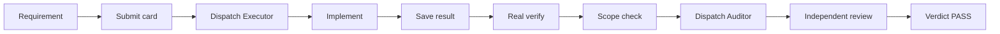
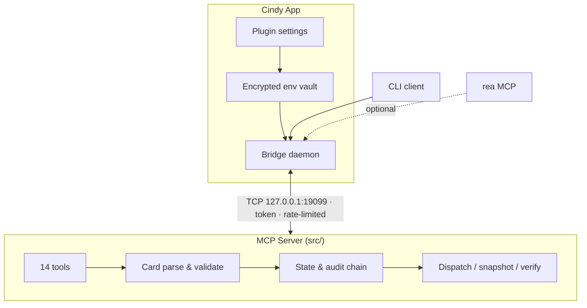

# Carlos Flow — Cindy Edition

> **Mechanical gatekeeping for AI coding agents**: Record → Dispatch → Verify → Verdict → Audit → Restore
> Turns "trust the agent" into "verify the agent" — with machine-enforced scope limits, real command execution, and a tamper-proof audit chain.
**语言 / Languages:** [中文](README.zh.md) | [English](README.en.md)
**版本 / Version:** 2.5.5 | **License:** MIT | **CI:** passing | **Node.js:** 22+ | **MCP:** 1.29+

---
## 🆕 What's new in v2.5.5
> In one line: **the workflow now recognises when it is its turn to step in.**

### ✨ Smart trigger engine (brand new)
No more manually saying "run the gate" every time. The engine reads your input, decides whether the Carlos workflow should start, and — crucially — **tells you why**.

| Layer | Component | What it does | Why it matters |
|-------|-----------|--------------|---------------|
| **L1** | `DynamicTriggerManager` | Dynamically computes "how many triggers are left in this session" | A fixed cap is either noisy or too strict; longer sessions and complex tasks automatically raise the ceiling |
| **L2** | `TriggerScorer` | Scores every message: keywords 50 + context 30 + intent 20, weighted to a **38**-point maximum | Whether to trigger must be **explainable** — you always see which words matched and how many points were scored |
| **L3** | `TriggerDecisionEngine` | Four-way decision: `trigger` / `review` / `ignore` / `throttled` | Turns "should we trigger?" from a hunch into an explicit rule |

**Key properties**
- 🎚️ **Dynamic cap**: `5 + sessionHours×0.5 + complexity×2 − triggersInWindow×0.3`, capped at 15
- 🛡️ **Non-intrusive**: 5-minute minimum interval per session; the more you trigger, the **lower** the cap (a penalty, not a bonus)
- 📊 **Transparent scoring**: returns the full `breakdown` (matched keywords / context words / intent type)
- ⚖️ **Honest under throttling**: even when throttled it returns the real score and confidence — it never pretends "0 points"
- 🧠 **Learns from feedback**: records accepted / rejected triggers and adjusts positive-negative weights
- 📦 **Zero external dependencies**: plain JavaScript, no new npm packages

### 🐛 7 real defects fixed
> These are all reproducible bugs, not "theoretical risks".

| # | Defect | Impact | Fix |
|---|--------|--------|-----|
| 1 | `client/carlos.js` is ESM but loaded the trigger engine with `require()`; the error was swallowed by `catch` | **Integration silently dead** — the engine never ran | Switched to dynamic `import()` |
| 2 | `canTrigger()` compared a 0–1 weighted average against a 5–15 cap | The cap check **could never fire** | Added `countTriggersInWindow()` returning the raw count |
| 3 | The history factor in the dynamic-cap formula was an **additive** term | More triggers meant a *higher* cap — the cap cancelled itself out | Changed to a **penalty** term (subtraction) |
| 4 | `processUserMessage()` hard-coded `sessionId='default'` | Ignored `context.sessionId`; sessions bled into each other | Session id now passed through from context |
| 5 | `src/trigger.js` detected its CLI entry via `import.meta.url.endsWith(process.argv[1])` | The `file:///` prefix meant it **never matched** — the CLI was decorative | Switched to `fileURLToPath()` + `resolve()` |
| 6 | `shouldTrigger()` returned early in the throttling branch | Score collapsed to `0` and confidence was lost | Score is now computed before throttling is judged |
| 7 | `test:trigger` wrote its result file into the publish directory | Polluted the published npm package | Now written to the system temp directory |

### 🔒 Security & hygiene
- 🚨 **`.gitignore` rule collision**: the trailing `*.tar.gz.npmrc.local` line meant `.npmrc.local` (which contains an **npm token**) was never actually ignored → split into separate rules
- 🏠 **State files no longer wander**: trigger state lands in `CARLOS_FLOW_HOME`, not the current working directory
- 🌐 **No hard-coded machine paths**: `D:\opencode-backups` → `~/.carlos-flow` (cross-platform default)
- 🧹 **42 one-off fix scripts and scratch files removed** (net −5325 lines)

### 🚀 Release engineering
- 🔑 **GitHub Actions OIDC publishing**: no npm token stored in the repository any more
- 🧩 **`scripts/release.mjs`**: version checks / bilingual consistency / tests / build / publish in one command
- 🛡️ **`npm run check:readme`**: prepublish hook keeps the three README files from drifting apart
- 📋 **Independent QA report**: [`docs/QA_REPORT_v2.5.5.md`](docs/QA_REPORT_v2.5.5.md) — 8/8 suites green across both repos

### 📚 Documentation readability
- Removed the repeated **language bar / version line noise** that was injected throughout the READMEs (24–26 occurrences per file → consolidated to 1 at the top); tables are no longer truncated
- Added [`TRIGGER_GUIDE.md`](TRIGGER_GUIDE.md): the complete smart-trigger guide

---
## 🎯 Why Carlos Flow?
Most AI coding workflows are **advisory**. The prompt says "only touch these files" — and the agent politely agrees, then rewrites half the repository. The prompt says "run the tests" — and the agent reports "tests pass" without ever running them.
Carlos Flow is **mechanical**. The constraints live in code, not in prose.
### Pain points it removes
| Pain | Typical state today | Carlos Flow's answer |
|------|--------------------|---------------------|
| **Scope creep** | "Only edit `src/auth.py`" — a suggestion, not a rule | `enforceScope()` compares real `git diff` output against the card's whitelist; out-of-scope files **block the dispatch** |
| **Verification theatre** | Agent claims "tests pass"; nobody can prove it | `runVerifyCommand()` actually spawns `verify.cmd`, captures `stdout` / `stderr` / `exitCode` |
| **Laundered audit logs** | Logs in a plain file — deletable, editable | SHA-256 **chained** audit log (`prevHash` → `hash`); altering one record breaks the chain |
| **Runaway bypass mode** | One sentence ("skip the gate, it's urgent") disables everything | Bypass requires an explicit `confirmed=true` on the card and **auto-resets on every dispatch** |
| **Infinite dispatch budget** | Claiming a slot resets the counter — unlimited retries | `dispatch_count` increments **only on dispatch**; quota exhaustion blocks both claim and dispatch |
| **Forgotten daemons** | "Did you start the server?" / port already in use | Bridge is auto-launched on first call, health-checked, token-authenticated, rate-limited |
| **Self-attested reviews** | Same agent implements *and* approves | Built-in `auditor` role with a separate contract; verdict is one of `PASS` / `DIRECTION` / `LOCAL` |
| **No way back from a bad change** | Manual `git revert` only | Automatic snapshot before dispatch → `flow_revert_plan` produces an atomic restore plan |
| **Manual kick-off every time** | "run the gate" — if you forget, you work unprotected | The **smart trigger engine** scores your input and only fires when the intent is clear |
### How it differs
| Capability | **Carlos Flow** | Raw MCP server | Prompt-only / scripts |
|------------|-----------------|-----------------|----------------------|
| **Scope enforcement** | ✅ runtime `git diff` level | ❌ none | ❌ relies on goodwill |
| **Real verification** | ✅ spawns the command, captures output | ❌ none | ❌ agent self-reports |
| **Tamper-proof audit** | ✅ SHA-256 chained | ❌ none | ❌ none |
| **Controlled bypass** | ✅ explicit + auto-reset | ❌ none | ❌ one-liner disables all |
| **Honest dispatch quota** | ✅ counts dispatch only | ❌ none | ❌ none |
| **Independent review** | ✅ built-in `auditor` role | ❌ none | ❌ optional |
| **Snapshot + restore** | ✅ automatic, atomic plan | ❌ none | ❌ manual `git revert` |
| **Daemon lifecycle** | ✅ automatic (Cindy edition) | ❌ manual | ❌ manual |

---
## 🚀 Quick start (30 seconds)
### Option 1 — Cindy plugin marketplace (recommended)
1. Cindy → Settings → Plugins → Browse marketplace
2. Search `carlos-flow`, click install
3. Fill in the environment variables on the plugin settings page
4. **Fully quit and restart Cindy**, then say *"走门禁"* / *"run the gate"*
### Option 2 — from source
```bash
git clone https://github.com/skyer-now/carlos-flow-cindy.git
cd carlos-flow-cindy
npm install
cp .env.example .env      # edit: CARLOS_FLOW_MCP_ROOT, CARLOS_FLOW_HOME
npm test                  # smoke test (fully isolated)
npm run test:e2e          # 16-case end-to-end suite
```

---
## 🌟 Core capabilities
#### 🆕 Smart trigger engine — `src/trigger.js`
> **Three layers of perception**: decides *before* the workflow starts whether this is the moment to run the gate — and shows its reasoning.

```javascript
import TriggerEngine from './src/trigger.js';

const engine = TriggerEngine.create('session-123');
const result = engine.shouldTrigger('run dispatch workflow', { complexity: 1.2 });

// {
//   shouldTrigger: true,
//   decision: 'trigger',        // trigger | review | ignore | throttled
//   score: 37,                  // weighted total, 0~38
//   confidence: 0.9,
//   breakdown: { keyword: {...}, context: {...}, intent: {...} },
//   action: { type: 'workflow_trigger', recommendedAction: 'auto' }
// }
```

- **L1 dynamic cap** — `5 + sessionHours×0.5 + complexity×2 − triggersInWindow×0.3`, capped at 15
- **L2 trigger scoring** — keywords (0–50, weight 0.5) + context (0–30, weight 0.3) + intent (0–20, weight 0.2), weighted maximum **38**
- **L3 decision engine** — four outcomes: `trigger` / `review` (borderline, needs confirmation) / `ignore` (below 10) / `throttled` (rate-limited)
- **Tunable thresholds** — `triggerThreshold: 15`, `autoTriggerThreshold: 25`, `lowConfidenceThreshold: 10`
- **Zero external dependencies** — plain JavaScript, no new npm packages
- **Learns from feedback** — records accepted / rejected triggers and adjusts positive-negative weights

> Full configuration and usage: [TRIGGER_GUIDE.md](TRIGGER_GUIDE.md)

### 1️⃣ Real verification — `flow_run_verify`
```typescript
const result = await runVerifyCommand(card.verify.cmd, cwd);
// { ok: boolean, exitCode: number, stdout: string, stderr: string, durationMs: number }
```
Actually spawns the command. Captures full output. 60-second circuit breaker. No "trust me, it passed."
### 2️⃣ Scope enforcement — `flow_check_scope`
```typescript
const result = enforceScope(scopeWhitelist, changedFiles);
// { ok: boolean, violations: string[] }
```
Machine-level comparison of the working tree against the card's whitelist. File-level precision, zero false positives on unchanged files.
### 3️⃣ Tamper-proof audit chain — `verifyAuditChain`
```typescript
const result = verifyAuditChain({ sinceIndex: 0 });
// { ok: boolean, brokenAt?: number, detail?: string }
```
Every record carries `prevHash`, `hash` and `seq`. A single edited byte invalidates everything downstream — mathematically, not administratively.
### 4️⃣ Controlled bypass — `flow_bypass` + `isBypassed()`
- Must be explicitly enabled (`bypass=true` **and** `confirmed=true`)
- Auto-resets on every dispatch — you cannot "forget to turn it off"
- Every toggle is written to the audit chain
### 5️⃣ Honest dispatch budget — `dispatch_count`
- Increments **only** in `flow_dispatch`; `flow_claim` / `flow_verdict` never count
- Quota exhaustion blocks **both** claim and dispatch
- No infinite-retry path
### 6️⃣ Snapshot & restore — `flow_dispatch` → `flow_revert_plan`
- Files in `scope` are snapshotted automatically before each dispatch
- `flow_revert_plan` emits an atomic, ordered restore plan (newest first)
- Partial rollback supported
### 7️⃣ Independent review — `auditor` role
- Separate four-part contract with an evidence-gathering mandate
- Auditor must run `git status --porcelain` / `git diff` itself
- Verdict enum is strict: `PASS` / `DIRECTION` / `LOCAL`

---
## 📖 Use cases
### Scenario 1 — New feature development

### Scenario 2 — Bug fix
- Card `quote` is anchored to the user's original words — the agent cannot silently redefine the request
- `scope` narrowed to the single file
- `verify.cmd` runs the regression test, not a hand-written summary
### Scenario 3 — Large refactor
- Multi-file `scope` managed as one whitelist
- Snapshots protect against a half-finished refactor
- Restore plan is the safety net
### Scenario 4 — Security audit / sensitive paths
- T2 risk tier requires explicit `confirmed=true`
- Sensitive paths (`config/`, `secrets/`, `infra/`, …) are flagged and gated
- Audit chain provides tamper-evident evidence trail
### Scenario 5 — CI / PR gating
- Same flow, driven from CI
- Verdict can block a merge
- Audit log archived for compliance

---
## 🏗️ Architecture

### Why a Bridge in the Cindy edition?
|  | Cindy edition (this repo) | OpenCode edition |
|---|---|---|
| Transport | TCP Bridge on `127.0.0.1:19099` | Pure stdio |
| Daemon lifecycle | **Automatic** — launched on first call, health-checked | Managed by OpenCode |
| Configuration | Plugin settings page + env vars | `.mcprc` / `opencode.json` |
| Secret storage | **Cindy encrypted vault** — no plaintext in code | Plaintext config (user-managed) |
| rea integration | Built-in `client/rea.js` | Register a second MCP server |
| Best for | Cindy App users | OpenCode 2.2.2+ users |

---
## 🛠️ The 14 tools
### 📝 Card & record
| Tool | Purpose | Key params |
|------|---------|------------|
| `flow_protocol` | Read the full protocol (tiers T0/T1/T2, contracts, error layers, state schema) | — |
| `flow_add_user_msg` | Record the user's original words (anchor source) | `sessionId`, `text` |
| `flow_submit_requirement` | Submit the task card (validate + record) | `goal`, `quote`, `scope`, `acceptance`, `confirmed` |
### 🚀 Dispatch & execution
| Tool | Purpose | Key params |
|------|---------|------------|
| `flow_claim` | Claim a dispatch slot, get the four-part contract | `sessionId`, `role` (`executor`\|`auditor`) |
| `flow_dispatch` | Generate the contract prompt + automatic file snapshot | `sessionId`, `role`, `message`, `run?` |
| `flow_run_verify` | **Really execute `verify.cmd`** | `sessionId` |
| `flow_check_scope` | **Machine-level scope enforcement** | `sessionId`, `paths[]` |
### ⚖️ Verdict & status
| Tool | Purpose | Key params |
|------|---------|------------|
| `flow_verdict` | Record the verdict (`PASS`/`DIRECTION`/`LOCAL`) | `sessionId`, `verdict`, `notes` |
| `flow_status` | Query the full gate state | `sessionId` |
### 🔍 Audit & forensics
| Tool | Purpose | Key params |
|------|---------|------------|
| `flow_audit` | Read the audit trail (filter by type/time/session) | `sessionId`, `type?`, `since?` |
| `flow_diff_hunks` | git diff hunk-level analysis | `sessionId`, `scope?` |
| `flow_revert_plan` | Generate the atomic restore plan | `sessionId` |
### 🛡️ Bypass & restore
| Tool | Purpose | Key params |
|------|---------|------------|
| `flow_bypass` | Bypass switch (requires `confirmed`) | `sessionId`, `bypass`, `confirmed` |
> Full tool reference: call `flow_protocol` at runtime — it is the authoritative, machine-readable spec.

---
## ⚙️ Environment variables
| Variable | Required | Description | Example |
|----------|----------|-------------|---------|
| `CARLOS_FLOW_MCP_ROOT` | ✅ | MCP source root (contains `src/` `bridge/` `client/`) | `D:/cindy/carlos-flow-mcp` |
| `CARLOS_FLOW_HOME` | ✅ | State / audit / snapshot root | `~/carlos-flow` |
| `BRIDGE_PORT` | ❌ | Bridge listen port (default `19099`) | `19099` |
| `REA_MCP_ROOT` | ❌ | rea MCP source root | `D:/dev-env/rea` |
| `GHIDRA_HOME` | ❌ | Ghidra install dir | `D:/dev-env/ghidra/ghidra_12.1.4_PUBLIC` |
| `JAVA_HOME` | ❌ | JDK 21 install dir | `D:/dev-env/jdk-21.0.12.1+1` |
| `NODE_PATH` | ❌ | Node.js executable path (default `node`) | `node` |
> **Tip**: changes made on the Cindy plugin settings page require a **full Cindy restart** to take effect.

---
## 🧪 Testing
```bash
npm test              # smoke test — isolated temp dir, < 10s
npm run test:e2e      # 16-case end-to-end suite
npm run test:p0       # 10-case gate suite (role whitelist / scope / bypass confirmation …)
npm run test:trigger  # 15-case trigger engine suite (incl. 4 regression cases)
npm run test:all      # all four suites chained
```
> No environment setup needed locally (the suites fall back to the repo root automatically). CI runs all four suites on **ubuntu-latest** and **windows-latest** for every push and pull request.

---
## 📋 Changelog
Full history → [CHANGELOG.md](CHANGELOG.md)
### v2.5.5 — 2026-11-05 · Smart trigger engine + 7 real defects fixed
| Type | Change |
|------|--------|
| ✨ New | Smart trigger engine (`src/trigger.js`): L1 dynamic cap / L2 three-axis scoring / L3 four-way decision |
| ✨ New | `TRIGGER_GUIDE.md` complete usage guide (config, scoring formula, troubleshooting) |
| ✨ New | `test/trigger-e2e.mjs` — 15 cases incl. 4 regression cases; `npm run test:all` chains all four suites |
| ✨ New | `scripts/release.mjs` release script + `npm run check:readme` bilingual consistency hook |
| ✨ New | `docs/QA_REPORT_v2.5.5.md` independent QA acceptance report (8/8 suites green) |
| 🐛 Fixed | Trigger engine silently swallowed by `require()` in the ESM client → dynamic `import()` |
| 🐛 Fixed | Trigger cap compared a 0–1 average against 5–15 → never fired → now uses the raw count |
| 🐛 Fixed | History factor in the dynamic cap was additive (more triggers → higher cap) → now a penalty |
| 🐛 Fixed | `processUserMessage()` hard-coded the session id → now passed through from context |
| 🐛 Fixed | Trigger CLI entry never matched because of the `file:///` prefix → `fileURLToPath()` |
| 🐛 Fixed | Score collapsed to 0 and confidence was lost while throttled → now reported honestly |
| 🐛 Fixed | Test result file written into the publish directory → now the system temp directory |
| 🔒 Security | `.gitignore` collision meant the npm-token-bearing `.npmrc.local` was never ignored → split rules |
| 🔒 Security | Trigger state written to the CWD → unified under `CARLOS_FLOW_HOME` |
| 🔒 Security | Hard-coded machine path → cross-platform `~/.carlos-flow` default |
| 🧹 Cleanup | 42 one-off fix scripts and scratch files removed (net −5325 lines) |
| 🔑 Release | GitHub Actions OIDC publishing — no npm token in the repo any more |
| 📚 Docs | Removed README language-bar / version-line noise (24–26 per file → 1 at the top) |

### v2.5.3 — 2026-11-04 · Fatal syntax fixes + verified gates
| Type | Change |
|------|--------|
| ✨ New tools | `flow_run_verify`, `flow_check_scope` |
| ✨ Core | `runVerifyCommand()` really executes `verify.cmd` |
| ✨ Core | `enforceScope()` machine-level scope enforcement |
| ✨ Core | `verifyAuditChain()` SHA-256 audit-chain validation |
| ✨ Core | `isBypassed()` real bypass semantics |
| 🐛 Fixed | role whitelist (only `executor`/`auditor`; typos now error) |
| 🐛 Fixed | `dispatch_count` increments on dispatch only |
| 🐛 Fixed | bypass auto-resets on new dispatch |
| 🐛 Fixed | stale-card / quota / verdict-enum / param validation |
> ⚠️ **v2.5.1 contained 18 P0 defects.** Upgrade to **v2.5.2 or later**.

---
## ❓ FAQ
| Symptom | Fix |
|---------|-----|
| Bridge port conflict (`EADDRINUSE`) | Change `BRIDGE_PORT`, or `lsof -ti:19099 \| xargs kill` |
| Plugin settings changes have no effect | **Fully quit Cindy and restart** (not minimize-to-tray) |
| Audit chain validation fails | Check `CARLOS_FLOW_HOME` permissions, or delete `audit/` and let it rebuild |
| Verification command times out | `verify.cmd` is killed after 60s — split it into fast commands |
| Scope violation false positive | Use relative paths in `scope`; `git diff --name-only` must match |
| The trigger engine never fires | Check whether your input hits the `keywordWeights` vocabulary; the default list is English, so extend it for other languages |
| The trigger engine fires too often | Raise `triggerThreshold`, increase `minTriggerIntervalSeconds`, or lower `historyCoeff` |
| Where do trigger state files live? | Under `CARLOS_FLOW_HOME` (default `~/.carlos-flow`) — never in the current working directory |

---
## 📄 License
MIT — see [LICENSE](LICENSE)

---
## 🤝 Contributing
PRs welcome! Please make sure `npm test` and `npm run test:e2e` pass first. See [CONTRIBUTING.md](CONTRIBUTING.md).

---
**Using OpenCode instead?** → [carlos-flow-opencode](https://github.com/skyer-now/carlos-flow-opencode) — pure stdio, no Bridge, configured via `.mcprc` / `opencode.json`.
