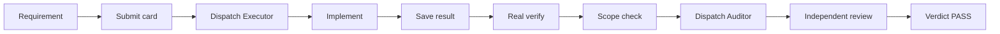
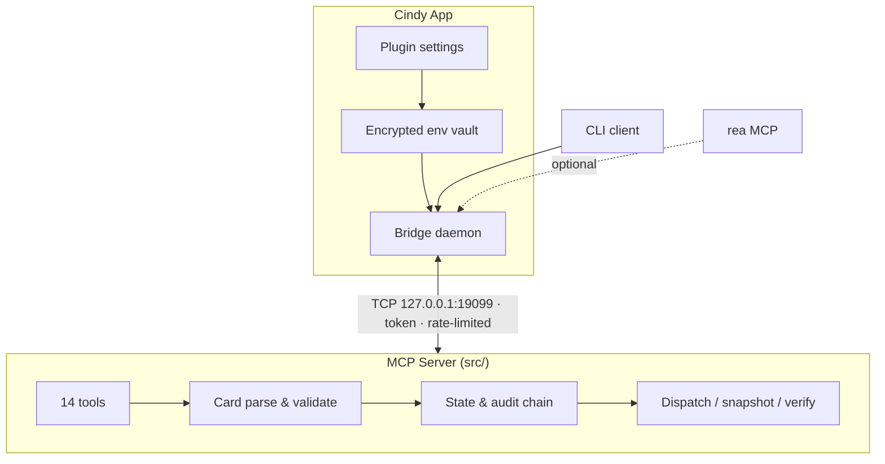

# Carlos Flow — Cindy Edition

> **Mechanical gatekeeping for AI coding agents**: Record → Dispatch → Verify → Verdict → Audit → Restore
> Turns "trust the agent" into "verify the agent" — with machine-enforced scope limits, real command execution, and a tamper-proof audit chain.

[](README.en.md)
[](README.zh.md)
[](https://www.npmjs.com/package/carlos-flow-cindy)
[](https://www.npmjs.com/package/carlos-flow-cindy)
[](LICENSE)
[](https://github.com/skyer-now/carlos-flow-cindy/actions/workflows/ci.yml)
[](https://nodejs.org/)
[](https://modelcontextprotocol.io)

---

## 🎯 Why Carlos Flow?

Most AI coding workflows are **advisory**. The prompt says "only touch these files" — and the agent politely agrees, then rewrites half the repository. The prompt says "run the tests" — and the agent reports "tests pass" without ever running them.

Carlos Flow is **mechanical**. The constraints live in code, not in prose.

### Pain points it removes

| Pain | Typical state today | Carlos Flow's answer |
|------|--------------------|---------------------|
| **Scope creep** | "Only edit `src/auth.py`" — a suggestion, not a rule | `enforceScope()` compares real `git diff` output against the card's whitelist; out-of-scope files **block the dispatch** |
| **Verification theatre** | Agent claims "tests pass"; nobody can prove it | `runVerifyCommand()` actually spawns `verify.cmd`, captures `stdout` / `stderr` / `exitCode` |
| **Laundered audit logs** | Logs in a plain file — deletable, editable | SHA-256 **chained** audit log (`prevHash` → `hash`); altering one record breaks the chain |
| **Runaway bypass mode** | One sentence ("skip the gate, it's urgent") disables everything | Bypass requires an explicit `confirmed=true` on the card and **auto-resets on every dispatch** |
| **Infinite dispatch budget** | Claiming a slot resets the counter — unlimited retries | `dispatch_count` increments **only on dispatch**; quota exhaustion blocks both claim and dispatch |
| **Forgotten daemons** | "Did you start the server?" / port already in use | Bridge is auto-launched on first call, health-checked, token-authenticated, rate-limited |
| **Self-attested reviews** | Same agent implements *and* approves | Built-in `auditor` role with a separate contract; verdict is one of `PASS` / `DIRECTION` / `LOCAL` |

### How it differs

| Capability | **Carlos Flow** | Raw MCP server | Prompt-only / scripts |
|------------|-----------------|-----------------|----------------------|
| **Scope enforcement** | ✅ runtime `git diff` level | ❌ none | ❌ relies on goodwill |
| **Real verification** | ✅ spawns the command, captures output | ❌ none | ❌ agent self-reports |
| **Tamper-proof audit** | ✅ SHA-256 chained | ❌ none | ❌ none |
| **Controlled bypass** | ✅ explicit + auto-reset | ❌ none | ❌ one-liner disables all |
| **Honest dispatch quota** | ✅ counts dispatch only | ❌ none | ❌ none |
| **Independent review** | ✅ built-in `auditor` role | ❌ none | ❌ optional |
| **Snapshot + restore** | ✅ automatic, atomic plan | ❌ none | ❌ manual `git revert` |
| **Daemon lifecycle** | ✅ automatic (Cindy edition) | ❌ manual | ❌ manual |

---

## 🚀 Quick start (30 seconds)

### Option 1 — Cindy plugin marketplace (recommended)

1. Cindy → Settings → Plugins → Browse marketplace
2. Search `carlos-flow`, click install
3. Fill in the environment variables on the plugin settings page
4. **Fully quit and restart Cindy**, then say *"走门禁"* / *"run the gate"*

### Option 2 — from source

```bash
git clone https://github.com/skyer-now/carlos-flow-cindy.git
cd carlos-flow-cindy
npm install
cp .env.example .env      # edit: CARLOS_FLOW_MCP_ROOT, CARLOS_FLOW_HOME
npm test                  # smoke test (fully isolated)
npm run test:e2e          # 16-case end-to-end suite
```

---

## 🌟 Core capabilities

### 1️⃣ Real verification — `flow_run_verify`

```typescript
const result = await runVerifyCommand(card.verify.cmd, cwd);
// { ok: boolean, exitCode: number, stdout: string, stderr: string, durationMs: number }
```

Actually spawns the command. Captures full output. 60-second circuit breaker. No "trust me, it passed."

### 2️⃣ Scope enforcement — `flow_check_scope`

```typescript
const result = enforceScope(scopeWhitelist, changedFiles);
// { ok: boolean, violations: string[] }
```

Machine-level comparison of the working tree against the card's whitelist. File-level precision, zero false positives on unchanged files.

### 3️⃣ Tamper-proof audit chain — `verifyAuditChain`

```typescript
const result = verifyAuditChain({ sinceIndex: 0 });
// { ok: boolean, brokenAt?: number, detail?: string }
```

Every record carries `prevHash`, `hash` and `seq`. A single edited byte invalidates everything downstream — mathematically, not administratively.

### 4️⃣ Controlled bypass — `flow_bypass` + `isBypassed()`

- Must be explicitly enabled (`bypass=true` **and** `confirmed=true`)
- Auto-resets on every dispatch — you cannot "forget to turn it off"
- Every toggle is written to the audit chain

### 5️⃣ Honest dispatch budget — `dispatch_count`

- Increments **only** in `flow_dispatch`; `flow_claim` / `flow_verdict` never count
- Quota exhaustion blocks **both** claim and dispatch
- No infinite-retry path

### 6️⃣ Snapshot & restore — `flow_dispatch` → `flow_revert_plan`

- Files in `scope` are snapshotted automatically before each dispatch
- `flow_revert_plan` emits an atomic, ordered restore plan (newest first)
- Partial rollback supported

### 7️⃣ Independent review — `auditor` role

- Separate four-part contract with an evidence-gathering mandate
- Auditor must run `git status --porcelain` / `git diff` itself
- Verdict enum is strict: `PASS` / `DIRECTION` / `LOCAL`

---

## 📖 Use cases

### Scenario 1 — New feature development


### Scenario 2 — Bug fix
- Card `quote` is anchored to the user's original words — the agent cannot silently redefine the request
- `scope` narrowed to the single file
- `verify.cmd` runs the regression test, not a hand-written summary

### Scenario 3 — Large refactor
- Multi-file `scope` managed as one whitelist
- Snapshots protect against a half-finished refactor
- Restore plan is the safety net

### Scenario 4 — Security audit / sensitive paths
- T2 risk tier requires explicit `confirmed=true`
- Sensitive paths (`config/`, `secrets/`, `infra/`, …) are flagged and gated
- Audit chain provides tamper-evident evidence trail

### Scenario 5 — CI / PR gating
- Same flow, driven from CI
- Verdict can block a merge
- Audit log archived for compliance

---

## 🏗️ Architecture



### Why a Bridge in the Cindy edition?

|  | Cindy edition (this repo) | OpenCode edition |
|---|---|---|
| Transport | TCP Bridge on `127.0.0.1:19099` | Pure stdio |
| Daemon lifecycle | **Automatic** — launched on first call, health-checked | Managed by OpenCode |
| Configuration | Plugin settings page + env vars | `.mcprc` / `opencode.json` |
| Secret storage | **Cindy encrypted vault** — no plaintext in code | Plaintext config (user-managed) |
| rea integration | Built-in `client/rea.js` | Register a second MCP server |
| Best for | Cindy App users | OpenCode 2.2.2+ users |

---

## 🛠️ The 14 tools

### 📝 Card & record
| Tool | Purpose | Key params |
|------|---------|------------|
| `flow_protocol` | Read the full protocol (tiers T0/T1/T2, contracts, error layers, state schema) | — |
| `flow_add_user_msg` | Record the user's original words (anchor source) | `sessionId`, `text` |
| `flow_submit_requirement` | Submit the task card (validate + record) | `goal`, `quote`, `scope`, `acceptance`, `confirmed` |

### 🚀 Dispatch & execution
| Tool | Purpose | Key params |
|------|---------|------------|
| `flow_claim` | Claim a dispatch slot, get the four-part contract | `sessionId`, `role` (`executor`\|`auditor`) |
| `flow_dispatch` | Generate the contract prompt + automatic file snapshot | `sessionId`, `role`, `message`, `run?` |
| `flow_run_verify` | **Really execute `verify.cmd`** | `sessionId` |
| `flow_check_scope` | **Machine-level scope enforcement** | `sessionId`, `paths[]` |

### ⚖️ Verdict & status
| Tool | Purpose | Key params |
|------|---------|------------|
| `flow_verdict` | Record the verdict (`PASS`/`DIRECTION`/`LOCAL`) | `sessionId`, `verdict`, `notes` |
| `flow_status` | Query the full gate state | `sessionId` |

### 🔍 Audit & forensics
| Tool | Purpose | Key params |
|------|---------|------------|
| `flow_audit` | Read the audit trail (filter by type/time/session) | `sessionId`, `type?`, `since?` |
| `flow_diff_hunks` | git diff hunk-level analysis | `sessionId`, `scope?` |
| `flow_revert_plan` | Generate the atomic restore plan | `sessionId` |

### 🛡️ Bypass & restore
| Tool | Purpose | Key params |
|------|---------|------------|
| `flow_bypass` | Bypass switch (requires `confirmed`) | `sessionId`, `bypass`, `confirmed` |

> Full tool reference: call `flow_protocol` at runtime — it is the authoritative, machine-readable spec.

---

## ⚙️ Environment variables

| Variable | Required | Description | Example |
|----------|----------|-------------|---------|
| `CARLOS_FLOW_MCP_ROOT` | ✅ | MCP source root (contains `src/` `bridge/` `client/`) | `D:/cindy/carlos-flow-mcp` |
| `CARLOS_FLOW_HOME` | ✅ | State / audit / snapshot root | `~/carlos-flow` |
| `BRIDGE_PORT` | ❌ | Bridge listen port (default `19099`) | `19099` |
| `REA_MCP_ROOT` | ❌ | rea MCP source root | `D:/dev-env/rea` |
| `GHIDRA_HOME` | ❌ | Ghidra install dir | `D:/dev-env/ghidra/ghidra_12.1.4_PUBLIC` |
| `JAVA_HOME` | ❌ | JDK 21 install dir | `D:/dev-env/jdk-21.0.12.1+1` |
| `NODE_PATH` | ❌ | Node.js executable path (default `node`) | `node` |

> **Tip**: changes made on the Cindy plugin settings page require a **full Cindy restart** to take effect.

---

## 🧪 Testing

```bash
npm test          # smoke test — isolated temp dir, < 10s
npm run test:e2e  # 16-case end-to-end suite
npm run test:rea  # 8-case real Ghidra analysis
```

CI runs on **ubuntu-latest** and **windows-latest** for every push and pull request.

---

## 📋 Changelog

Full history → [CHANGELOG.md](CHANGELOG.md)

### v2.5.2 — 2026-11-04 · Phase 1 P0 complete

| Type | Change |
|------|--------|
| ✨ New tools | `flow_run_verify`, `flow_check_scope` |
| ✨ Core | `runVerifyCommand()` really executes `verify.cmd` |
| ✨ Core | `enforceScope()` machine-level scope enforcement |
| ✨ Core | `verifyAuditChain()` SHA-256 audit-chain validation |
| ✨ Core | `isBypassed()` real bypass semantics |
| 🐛 Fixed | role whitelist (only `executor`/`auditor`; typos now error) |
| 🐛 Fixed | `dispatch_count` increments on dispatch only |
| 🐛 Fixed | bypass auto-resets on new dispatch |
| 🐛 Fixed | stale-card / quota / verdict-enum / param validation |

> ⚠️ **v2.5.1 contained 18 P0 defects.** Upgrade to **v2.5.2 or later**.

---

## ❓ FAQ

| Symptom | Fix |
|---------|-----|
| Bridge port conflict (`EADDRINUSE`) | Change `BRIDGE_PORT`, or `lsof -ti:19099 \| xargs kill` |
| Plugin settings changes have no effect | **Fully quit Cindy and restart** (not minimize-to-tray) |
| Audit chain validation fails | Check `CARLOS_FLOW_HOME` permissions, or delete `audit/` and let it rebuild |
| Verification command times out | `verify.cmd` is killed after 60s — split it into fast commands |
| Scope violation false positive | Use relative paths in `scope`; `git diff --name-only` must match |

---

## 📄 License

MIT — see [LICENSE](LICENSE)

---

## 🤝 Contributing

PRs welcome! Please make sure `npm test` and `npm run test:e2e` pass first. See [CONTRIBUTING.md](CONTRIBUTING.md).

---

**Using OpenCode instead?** → [carlos-flow-opencode](https://github.com/skyer-now/carlos-flow-opencode) — pure stdio, no Bridge, configured via `.mcprc` / `opencode.json`.
