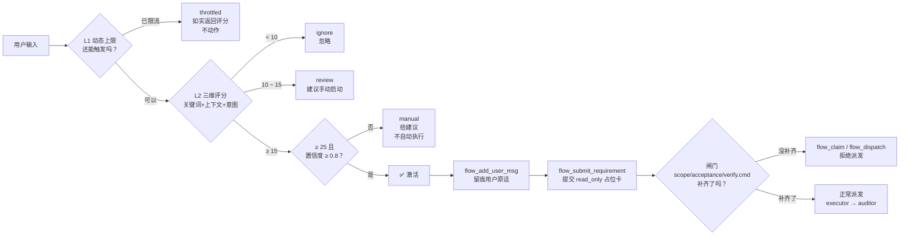
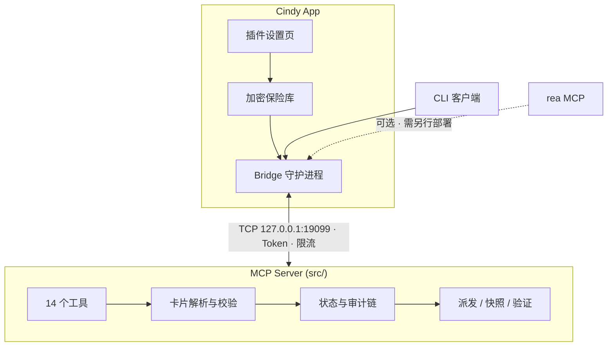

# Carlos Flow — Cindy 适配版

> **面向 AI 编码 Agent 的机械门禁**：留痕 → 派发 → 验证 → 裁定 → 审计 → 还原
> 把"相信 Agent"变成"验证 Agent"——机器级 scope 限制、真实命令执行、防篡改审计链。
**语言 / Languages:** [中文](README.zh.md) | [English](README.en.md)
**版本 / Version:** 2.5.5 | **License:** MIT | **CI:** passing | **Node.js:** 22+ | **MCP:** 1.29+

---
## 🆕 v2.5.5 更新速览
> 一句话：**工作流现在会自己认出该上场的时候。**

### ✨ 智能触发引擎（全新）
不再需要每次手动喊"走门禁"。引擎会读取你的输入，自动判断现在是否该启动 Carlos 工作流——并且**告诉你为什么**。

| 层 | 组件 | 做什么 | 为什么需要它 |
|----|------|--------|-------------|
| **L1** | `DynamicTriggerManager` | 动态计算"本会话还允许触发几次" | 固定上限要么太吵、要么太严；会话越长、任务越复杂，上限自动放宽 |
| **L2** | `TriggerScorer` | 给每条消息打分：关键词 50 + 上下文 30 + 意图 20，加权后满分 **38** | 触发与否必须**可解释**——每次都告诉你命中了哪些词、得了多少分 |
| **L3** | `TriggerDecisionEngine` | 四档决策：`trigger` / `review` / `ignore` / `throttled` | 把"要不要触发"从模糊直觉变成明确规则 |

**关键特性**
- 🎚️ **动态上限**：`5 + 会话时长(小时)×0.5 + 复杂度×2 − 窗口内已触发×0.3`，封顶 15
- 🛡️ **不打扰**：同会话最短间隔 5 分钟；触发越多上限**越低**（惩罚项，不是奖励项）
- 📊 **评分透明**：返回完整 `breakdown`（命中的关键词 / 上下文词 / 意图类型）
- ⚖️ **限流也如实**：被限流时照样返回真实评分与置信度，不假装"0 分"
- 🧠 **反馈学习**：记录你接受 / 拒绝的触发（持久化到会话状态）；**负反馈占多数时自动抬高触发阈值**，更保守
- 📦 **零外部依赖**：纯 JavaScript，不新增任何 npm 包

#### 🔁 动态决策 → 判断 → 激活（本次最关键的一环）
过去的实现只会在命中时**打一行日志**，并没有真的启动工作流。现在这一环补齐了：

| 阶段 | 动作 | 实际效果 |
|------|------|---------|
| **判断** | L1 上限 → L2 评分 → L3 四档决策 | 得到 `decision` + `score` + `confidence` + `breakdown` |
| **翻译** | `buildActivationPlan()` | 判定转成**可执行的 MCP 动作序列**（带 `auto` 标记） |
| **激活 ①** | `flow_add_user_msg` | 用户原话入库，成为任务卡 `quote` 的锚点数据源 |
| **激活 ②** | `flow_submit_requirement`（`activation: true`） | 提交 `read_only` 占位卡，**会话进入已留痕门禁态** |
| **闸门** | `activation_pending` | 字段补齐前，`flow_claim` / `flow_dispatch` / `flow_verdict` **一律拒绝**（防未执行就记 PASS 的假闭环） |
| **放行** | 重新提交完整卡 | 补齐后 `activation_pending` 清空 → 正常派发 |

> 安全约束：会话**已有任务卡**时自动激活会跳过开卡（不覆盖用户已有任务）；
> 自动激活只负责「留痕 + 进入门禁」，**绝不代替 Agent 决定改哪些文件**。
>
> **规则③：普通卡不上闸门** —— 提交**未标 `activation` 且该会话从未被激活过**的普通卡片时，**不会进入激活闸门**（`activation_pending` 保持为空）。档位必填项已由 `validateCard` 按 `tier` 强制（`read_only` 只需 `goal` + `quote`），此处再加闸门会误伤 T1 只读调研场景。

##### 🔐 门禁侧的四道防线（独立 QA 审计后加固）
| 防线 | 拦截什么 | 结果 |
|------|---------|------|
| **逐字段核验** | 只补了 `scope`、`acceptance`/`verify.cmd` 仍缺就提交 | 闸门**继续拦住**（`activation_pending` 精确列出还缺哪几项） |
| **未派发不许记 PASS** | 卡片刚提交、什么都没跑就想 `verdict=PASS` | 拒绝；`completed_ok` 保持 `false`（`DIRECTION`/`LOCAL` 不受影响，不误伤返工意见） |
| **空 scope fail-closed** | 卡片 `scope` 为空时改动任何文件 | `flow_check_scope` 判**全部越界**（早期实现是 fail-open，等于「白名单为空→随便改」） |
| **审计链专属事件** | 事后追问「这是不是占位卡？解闸过没有？」 | `activation` / `activation_gate_activated` / `activation_gate_held` / `activation_gate_unlocked` / `activation_released` / `verdict_denied` 六类事件可查 |

> 以上四道防线都有对应的**变异测试**（注入退化 → 确认测试会失败），共 13 类变异体 **13/13 全部被抓住**。
>
> 顺带修复：**触发状态原先所有会话共用一个文件**，会话之间互相限流 —— 现在按 session 分文件存放。

### 🐛 修复 7 项真实缺陷
> 这些都是能复现的实际问题，不是"可能的隐患"。

| # | 问题 | 影响 | 修复 |
|---|------|------|------|
| 1 | `client/carlos.js` 是 ESM 却用 `require()` 加载触发引擎，异常被 `catch` 吞掉 | **集成完全失效**，引擎从未真正运行 | 改用动态 `import()` |
| 2 | `canTrigger()` 拿 0~1 的加权均值去和上限 5~15 比较 | 上限检查**永远不会触发** | 新增 `countTriggersInWindow()` 返回原始次数 |
| 3 | 动态上限公式里历史因子是**加项** | 触发越多上限反而越高，封顶逻辑自我抵消 | 改为**惩罚项**（减法） |
| 4 | `processUserMessage()` 硬编码 `sessionId='default'` | 忽略 `context.sessionId`，多会话互相串味 | 按上下文透传 |
| 5 | `src/trigger.js` 用 `import.meta.url.endsWith(process.argv[1])` 判断 CLI 入口 | `file:///` 前缀导致**永不匹配**，CLI 形同虚设 | 改用 `fileURLToPath()` + `resolve()` |
| 6 | `shouldTrigger()` 在限流分支提前 `return` | 评分丢成 `0`、置信度丢失，调用方无法判断 | 改为先算评分再判限流 |
| 7 | `test:trigger` 把结果文件写进发布目录 | 污染 npm 包内容 | 改为写入系统临时目录 |

### 🔒 安全与整洁
- 🚨 **`.gitignore` 规则粘连**：末行 `*.tar.gz.npmrc.local` 让 `.npmrc.local`（**含 npm token**）根本没被忽略 → 已拆为独立规则
- 🏠 **状态文件不再乱跑**：触发器状态统一落到 `CARLOS_FLOW_HOME`，不再写进当前工作目录
- 🌐 **去掉硬编码机器路径**：`D:\opencode-backups` → `~/.carlos-flow`（跨平台默认）
- 🧹 **清理 42 个一次性修复脚本**与临时产物（净删 5325 行）

### 🚀 发布工程
- 🔑 **GitHub Actions OIDC 发布**：不再需要在仓库里存 npm token
- 🧩 **`scripts/release.mjs`**：一条命令跑完版本校验 / 双语一致性 / 测试 / 构建 / 发布
- 🛡️ **`npm run check:readme`**：prepublish 钩子自动校验 README 三份文件不漂移
- 📋 **独立 QA 验收报告**：[`docs/QA_REPORT_v2.5.5.md`](docs/QA_REPORT_v2.5.5.md)（发布前第三方只读验收）
- 🧬 **变异测试报告**：[`docs/MUTATION_REPORT_v2.5.5.md`](docs/MUTATION_REPORT_v2.5.5.md)（13 类变异体 **13/13 全部被抓住**）

### 📚 文档可读性
- 清理了 README 中被重复注入的**语言栏 / 版本行噪音**（每份 24~26 处 → 收敛到顶部 1 处），表格不再被截断
- 新增 [`TRIGGER_GUIDE.md`](TRIGGER_GUIDE.md)：智能触发引擎完整使用指南

---
## 🎯 为什么选择 Carlos Flow？
绝大多数 AI 编码流程是**建议性的**。提示词写"只改这些文件"——Agent 客气地点头，然后把半个仓库重写了。提示词写"跑一下测试"——Agent 汇报"测试通过"，其实根本没跑。
Carlos Flow 是**机械性的**。约束写在代码里，不写在散文里。
### 消除的痛点
| 痛点 | 今天的典型状态 | Carlos Flow 的答案 |
|------|----------------|-------------------|
| **越界改动** | "只改 `src/auth.py`"——是建议，不是规则 | `enforceScope()` 用真实 `git diff` 对比卡片白名单，越界文件**直接阻断派发** |
| **验证表演** | Agent 声称"测试通过"，无人能证明 | `runVerifyCommand()` 真实 spawn `verify.cmd`，捕获 `stdout`/`stderr`/`exitCode`；且记 `PASS` 前**必须**有验证通过的证据 |
| **可洗白的审计日志** | 普通文件里的日志——可删可改 | SHA-256 **链式**审计日志（`prevHash`→`hash`），改一条全链断裂 |
| **失控的免检模式** | 一句话（"这很急，跳过门禁"）关闭所有防护 | 免检需卡片显式 `confirmed=true`，且**每次派发自动清零** |
| **无限派发额度** | 领卡即重置计数——可无限重试 | `dispatch_count` **只在派发时** +1；配额耗尽同时拦截 claim 和 dispatch |
| **忘记拉起守护进程** | "你启动服务了吗？" / 端口已被占用 | Bridge 首次调用自动拉起、健康检查、Token 认证、限流 |
| **自证式复核** | 同一个 Agent 既实现又审批 | 内置 `auditor` 角色，独立合同；裁定严格三档 `PASS`/`DIRECTION`/`LOCAL` |
| **改坏了无法回退** | 只能手动 `git revert` | 派发前自动快照 → `flow_revert_plan` 生成原子还原计划 |
| **每次都要手动喊话启动** | "走门禁""开始流程"——不喊就不启动，忘了就裸奔 | **智能触发引擎**自动识别意图，评分达标才触发，且告诉你命中了什么 |
### 差异对比
| 能力 | **Carlos Flow** | 原生 MCP Server | 提示词 / 手写脚本 |
|------|-----------------|-----------------|------------------|
| **越界拦截** | ✅ 运行时 `git diff` 级 | ❌ 无 | ❌ 靠自觉 |
| **真实验证** | ✅ spawn 执行并捕获输出，记 PASS 需验证通过 | ❌ 无 | ❌ Agent 自述 |
| **防篡改审计** | ✅ SHA-256 链式哈希 | ❌ 无 | ❌ 无 |
| **可控免检** | ✅ 显式开启 + 自动清零 | ❌ 无 | ❌ 一句话全关 |
| **诚实派发配额** | ✅ 只计派发 | ❌ 无 | ❌ 无 |
| **独立复核** | ✅ 内置 `auditor` 角色 | ❌ 无 | ❌ 可选 |
| **快照 + 还原** | ✅ 自动、原子计划 | ❌ 无 | ❌ 手动 `git revert` |
| **守护进程生命周期** | ✅ 全自动（Cindy 版） | ❌ 手动 | ❌ 手动 |

---
## 🚀 30 秒快速开始
### 方式一：Cindy 插件市场（推荐）
1. Cindy → 设置 → 插件 → 浏览市场
2. 搜索 `carlos-flow` 点击安装
3. 在插件设置页填写环境变量
4. **完全退出 Cindy 重启**，然后说"走门禁"
### 方式二：从源码安装
```bash
git clone https://github.com/skyer-now/carlos-flow-cindy.git
cd carlos-flow-cindy
npm install
cp .env.example .env      # 编辑：CARLOS_FLOW_MCP_ROOT、CARLOS_FLOW_HOME
npm test                  # 冒烟测试（完全隔离）
npm run test:e2e          # 45 项端到端用例
```

---
## 🌟 核心能力
#### 🆕 智能触发引擎 — `src/trigger.js`
> **动态决策 → 判断 → 激活** 的完整闭环：自动判断"现在是不是该走门禁"，并把判断转成**真实执行**的门禁动作。

##### 🔁 决策与激活全流程


##### 激活做了什么（不是只打一行日志）
| 阶段 | 动作 | 效果 |
|------|------|------|
| **判断** | L1 上限 → L2 评分 → L3 四档决策 | 得到 `decision` + `score` + `confidence` + `breakdown` |
| **翻译** | `buildActivationPlan()` | 判定转成**可执行的 MCP 动作序列**（带 `auto` 标记） |
| **激活 ①** | `flow_add_user_msg` | 用户原话入库，成为任务卡 `quote` 的锚点数据源 |
| **激活 ②** | `flow_submit_requirement`（`activation: true`） | 提交 `read_only` 占位卡，**会话进入已留痕门禁态**，审计链记录激活事件 |
| **闸门** | `activation_pending` | 在 `scope` / `acceptance` / `verify.cmd` 补齐前，`flow_claim` / `flow_dispatch` / `flow_verdict` **一律拒绝派发** |
| **放行** | 重新提交完整卡 | 补齐字段后重新提交 → `activation_pending` 清空 → 正常派发 |

> 💡 **安全约束**：会话**已有任务卡**时自动激活会跳过开卡（不覆盖用户已有任务）；
> 自动激活只负责"留痕 + 进入门禁"，**绝不代替 Agent 决定改哪些文件**。

##### 代码用法
```javascript
import TriggerEngine from './src/trigger.js';

const engine = TriggerEngine.create('session-123');
const result = engine.shouldTrigger('run dispatch workflow', { complexity: 1.2 });

// {
//   shouldTrigger: true,
//   decision: 'trigger',        // trigger | review | ignore | throttled
//   score: 38,                  // 0~38 加权总分
//   confidence: 0.9,
//   breakdown: { keyword: {...}, context: {...}, intent: {...} },
//   action: { type: 'workflow_trigger', recommendedAction: 'auto' },
//   activationPlan: {           // ← 判断 → 激活 的翻译结果
//     activated: true,
//     steps: [
//       { tool: 'flow_add_user_msg',      auto: true  },
//       { tool: 'flow_submit_requirement', auto: true  },
//       { tool: 'flow_submit_requirement', auto: false, needsFill: ['scope','acceptance','verify.cmd'] }
//     ],
//     pendingFields: ['scope', 'acceptance', 'verify.cmd'],
//     prompt: '【Carlos 触发引擎已激活工作流】…'
//   }
// }
```

##### CLI 一键激活
```bash
# triggerMessage 传入真实用户原话（也可用环境变量 CARLOS_TRIGGER_MESSAGE）
node client/carlos.js flow_status '{"sessionId":"my-task","triggerMessage":"run dispatch workflow"}'
```
> ⚠️ `triggerMessage` **必须显式传入**，且默认词表是英文（`work` / `flow` / `carlos` / `dispatch` / `trigger` / `start` / `run` / `execute`）；
> 不传则**完全不启用自动触发**。中文场景请通过 `trigger-config.json` 扩展 `keywordWeights`。

输出（stderr）：
> 注：这里的 **37** 是 CLI 不带 `complexity` 时的值；代码示例里传了 `complexity: 1.2`，对应 **38**。
```
[Carlos Trigger] 判定触发：评分 37 · 置信度 0.9
[Carlos Trigger] 已执行激活步骤：flow_add_user_msg（写入用户原话…）
[Carlos Trigger] 已执行激活步骤：flow_submit_requirement（开卡：会话置为已留痕状态…）
【Carlos 触发引擎已激活工作流】…请补齐 scope / acceptance / verify.cmd 后重新提交…
```

##### 引擎要点
- **L1 动态上限** — `5 + 会话时长×0.5 + 复杂度×2 − 窗口内已触发×0.3`，封顶 15
- **L2 触发评分** — 关键词（0~50，权重 0.5）+ 上下文（0~30，权重 0.3）+ 意图（0~20，权重 0.2），加权满分 **38**
- **L3 决策引擎** — 四档：`trigger`（达标触发）/ `review`（临界待确认）/ `ignore`（低于 10 分忽略）/ `throttled`（限流）
- **会话隔离** — 触发历史与限流状态**按 session 分文件存放**，多会话互不干扰
- **阈值可配** — `triggerThreshold: 15`、`autoTriggerThreshold: 25`、`lowConfidenceThreshold: 10`
- **零外部依赖** — 纯 JavaScript，不新增任何 npm 包
- **用户反馈学习** — 记录接受 / 拒绝（持久化）；负反馈占多数时**自动抬高触发阈值**（更保守），正反馈多则更灵敏

> 完整配置项与用法：[TRIGGER_GUIDE.md](TRIGGER_GUIDE.md)

### 1️⃣ 真实验证 — `flow_run_verify`
```typescript
const result = await runVerifyCommand(card.verify.cmd, cwd);
// { ok: boolean, exitCode: number, stdout: string, stderr: string, durationMs: number }
```
真实 spawn 子进程，捕获完整输出，60 秒熔断。不再是"相信我，跑过了"。
### 2️⃣ 越界拦截 — `flow_check_scope`
```typescript
const result = enforceScope(scopeWhitelist, changedFiles);
// { ok: boolean, violations: string[] }
```
机器级对比工作区变更与卡片白名单，文件级精度，未改动文件零误报。
### 3️⃣ 防篡改审计链 — `verifyAuditChain`
```typescript
const result = verifyAuditChain({ sinceIndex: 0 });
// { ok: boolean, brokenAt?: number, detail?: string }
```
每条记录携带 `prevHash`、`hash`、`seq`。改动一个字节，下游全部失效——是数学保证，不是管理保证。
### 4️⃣ 可控免检 — `flow_bypass` + `isBypassed()`
- 必须显式开启（`bypass=true` **且** `confirmed=true`）
- 每次派发自动清零——不可能"忘记关掉"
- 每次开关都写入审计链
### 5️⃣ 诚实派发配额 — `dispatch_count`
- **只在** `flow_dispatch` 递增；`flow_claim` / `flow_verdict` 永不计数
- 配额耗尽同时阻断 claim 与 dispatch
- 无无限重试路径
### 6️⃣ 快照与还原 — `flow_dispatch` → `flow_revert_plan`
- `scope` 内文件在每次派发前自动快照
- `flow_revert_plan` 输出原子化、有序（由新到旧）的还原计划
- 支持部分回滚
### 7️⃣ 独立复核 — `auditor` 角色
- 独立的四段合同，强制自行取证
- Auditor 必须自己跑 `git status --porcelain` / `git diff`
- 裁定枚举严格：`PASS` / `DIRECTION` / `LOCAL`

---
## 📖 典型场景
### 场景 1 — 新功能开发

### 场景 2 — Bug 修复
- 卡片 `quote` 锚定用户原话——Agent 不能悄悄改写需求
- `scope` 收窄到单文件
- `verify.cmd` 跑的是回归测试，不是手写总结
### 场景 3 — 大规模重构
- 多文件 `scope` 统一白名单管理
- 快照兜底半途而废的重构
- 还原计划是最后的安全网
### 场景 4 — 安全审计 / 敏感路径
- T2 风险档强制要求 `confirmed=true`
- 敏感路径（`config/`、`secrets/`、`infra/` 等）自动标记并拦截
- 审计链提供防篡改证据链
### 场景 5 — CI / PR 门禁
- 同一套流程，由 CI 驱动
- 裁定结果可阻断合并
- 审计日志归档以备合规

---
## 🏗️ 架构

### Cindy 版为什么要用 Bridge？
| 维度 | Cindy 版（本仓库） | OpenCode 版 |
|------|------------------|-------------|
| 传输协议 | TCP Bridge `127.0.0.1:19099` | 纯 stdio |
| 守护进程 | **全自动**——首次调用拉起、健康检查 | 由 OpenCode 托管 |
| 配置方式 | 插件设置页 + 环境变量 | `.mcprc` / `opencode.json` |
| 密钥存储 | **Cindy 加密保险库**，代码零明文 | 明文配置（用户自行管理） |
| rea 集成 | 另行注册 rea MCP server（需 `REA_MCP_ROOT`/`GHIDRA_HOME`） | 另行注册 rea MCP server |
| 适用场景 | Cindy App 用户 | OpenCode 2.2.2+ 用户 |

---
## 🛠️ 14 个工具
### 📝 卡片与留痕
| 工具 | 作用 | 关键参数 |
|------|------|----------|
| `flow_protocol` | 读取完整协议（档位 T0/T1/T2、合同、错误分层、状态 schema） | — |
| `flow_add_user_msg` | 写入用户原话（锚点数据源） | `sessionId`, `text` |
| `flow_submit_requirement` | 提交任务卡（校验 + 留痕） | `goal`, `quote`, `scope`, `acceptance`, `confirmed` |
### 🚀 派发与执行
| 工具 | 作用 | 关键参数 |
|------|------|----------|
| `flow_claim` | 领取派发名额，返回四段合同 | `sessionId`, `role`（`executor`\|`auditor`） |
| `flow_dispatch` | 生成合同 prompt + 自动文件快照 | `sessionId`, `role`, `message`, `run?` |
| `flow_run_verify` | **真实执行 `verify.cmd`** | `sessionId` |
| `flow_check_scope` | **机器级 scope 越界拦截** | `sessionId`, `paths[]` |
### ⚖️ 裁定与状态
| 工具 | 作用 | 关键参数 |
|------|------|----------|
| `flow_verdict` | 记录裁定（`PASS`/`DIRECTION`/`LOCAL`） | `sessionId`, `verdict`, `notes` |
| `flow_status` | 查询完整门禁状态 | `sessionId` |
### 🔍 审计与取证
| 工具 | 作用 | 关键参数 |
|------|------|----------|
| `flow_audit` | 读取审计流水（按类型/时间/会话筛选） | `sessionId`, `type?`, `since?` |
| `flow_diff_hunks` | git diff hunk 级分析 | `sessionId`, `scope?` |
| `flow_revert_plan` | 生成原子还原计划 | `sessionId` |
### 🛡️ 免检与还原
| 工具 | 作用 | 关键参数 |
|------|------|----------|
| `flow_bypass` | 免检开关（需 `confirmed`） | `sessionId`, `bypass`, `confirmed` |
> 完整工具参考：运行时调用 `flow_protocol`，它是权威的机器可读规范。

---
## ⚙️ 环境变量
| 变量 | 必填 | 说明 | 示例 |
|------|------|------|------|
| `CARLOS_FLOW_MCP_ROOT` | ✅ | MCP 源码根目录（含 `src/` `bridge/` `client/`） | `D:/cindy/carlos-flow-mcp` |
| `CARLOS_FLOW_HOME` | ✅ | 状态 / 审计 / 快照根目录 | `~/carlos-flow` |
| `BRIDGE_PORT` | ❌ | Bridge 监听端口（默认 `19099`） | `19099` |
| `REA_MCP_ROOT` | ❌ | rea MCP 源码根目录 | `D:/dev-env/rea` |
| `GHIDRA_HOME` | ❌ | Ghidra 安装目录 | `D:/dev-env/ghidra/ghidra_12.1.4_PUBLIC` |
| `JAVA_HOME` | ❌ | JDK 21 安装目录 | `D:/dev-env/jdk-21.0.12.1+1` |
| `NODE_PATH` | ❌ | Node.js 可执行文件路径（默认 `node`） | `node` |
> **提示**：插件设置页修改后需**完全退出 Cindy 重启**生效。

---
## 🧪 测试
```bash
npm test                   # 冒烟测试——隔离临时目录，< 10s
npm run test:e2e           # 45 项端到端用例
npm run test:p0            # 15 项门禁专项（role 白名单 / 越界 / 免检确认 …）
npm run test:trigger       # 25 项触发引擎用例（含 10 项回归）
npm run test:concurrency   # 3 项跨进程并发回归
npm run test:all           # 五个套件串联，一次跑完
```
> 本地运行无需额外配置环境变量（测试脚本会自动回退到仓库根目录）；CI 在 **ubuntu-latest** 与 **windows-latest** 上对每次 push / pull request 运行全部五个套件。

---
## 📋 变更日志
完整历史 → [CHANGELOG.md](CHANGELOG.md)
### v2.5.5 — 2026-11-05 · 智能触发引擎 + 7 项真实缺陷修复
| 类型 | 变更 |
|------|------|
| ✨ 新增 | 智能触发引擎（`src/trigger.js`）：L1 动态上限 / L2 三维评分 / L3 四档决策 |
| ✨ 新增 | `TRIGGER_GUIDE.md` 完整使用指南（配置、评分公式、故障排查） |
| ✨ 新增 | `test/trigger-e2e.mjs` 25 项用例（含 10 项回归）+ `npm run test:all` 串联五套件 |
| ✨ 新增 | `scripts/release.mjs` 发布脚本 + `npm run check:readme` 双语一致性钩子 |
| ✨ 新增 | `docs/QA_REPORT_v2.5.5.md` 独立 QA 验收报告（5 套件全绿） |
| 🐛 修复 | 触发引擎在 ESM 客户端中被 `require()` 静默吞掉 → 改用动态 `import()` |
| 🐛 修复 | 触发上限检查用 0~1 均值比 5~15 → 永不触发 → 改用原始次数 |
| 🐛 修复 | 动态上限历史因子为加项（触发越多上限越高）→ 改为惩罚项 |
| 🐛 修复 | `processUserMessage()` 硬编码 sessionId → 按上下文透传 |
| 🐛 修复 | 触发引擎 CLI 入口因 `file:///` 前缀永不匹配 → 改用 `fileURLToPath()` |
| 🐛 修复 | 限流时评分丢成 0、置信度缺失 → 如实返回 |
| 🐛 修复 | 测试结果文件写入发布目录 → 改写系统临时目录 |
| 🔒 安全 | `.gitignore` 粘连导致含 npm token 的 `.npmrc.local` 未被忽略 → 拆分规则 |
| 🔒 安全 | 触发器状态文件写入 CWD → 统一到 `CARLOS_FLOW_HOME` |
| 🔒 安全 | 硬编码机器路径 → `~/.carlos-flow` 跨平台默认 |
| 🧹 清理 | 42 个一次性修复脚本与临时产物（净删 5325 行） |
| 🔑 发布 | GitHub Actions OIDC 发布，不再需要仓库内 npm token |
| 📚 文档 | 清理 README 语言栏/版本行噪音（每份 24~26 处 → 顶部 1 处） |

### v2.5.3 — 2026-11-04 · 致命语法错误修复 + 门禁真验证
| 类型 | 变更 |
|------|------|
| ✨ 新增工具 | `flow_run_verify`、`flow_check_scope` |
| ✨ 核心 | `runVerifyCommand()` 真实执行 `verify.cmd` |
| ✨ 核心 | `enforceScope()` 机器级 scope 越界拦截 |
| ✨ 核心 | `verifyAuditChain()` SHA-256 审计链校验 |
| ✨ 核心 | `isBypassed()` 免检模式真实判定 |
| 🐛 修复 | role 白名单（仅 `executor`/`auditor`，拼错即报错） |
| 🐛 修复 | `dispatch_count` 仅在 dispatch 时递增 |
| 🐛 修复 | 免检状态在新派发时自动清零 |
| 🐛 修复 | 过期卡 / 配额 / 裁定枚举 / 参数校验 |
> ⚠️ **v2.5.1 存在 18 项 P0 缺陷**，请升级到 **v2.5.2 或更高版本**。

---
## ❓ 常见问题
| 现象 | 解决 |
|------|------|
| Bridge 端口冲突（`EADDRINUSE`） | 改 `BRIDGE_PORT`，或 `lsof -ti:19099 \| xargs kill` |
| 插件设置页改完不生效 | **完全退出 Cindy 并重启**（不是最小化到托盘） |
| 审计链校验失败 | 检查 `CARLOS_FLOW_HOME` 权限，或删除 `audit/` 重建 |
| 验证命令超时 | `verify.cmd` 超过 60s 会被熔断，建议拆成快速命令 |
| scope 越界误报 | `scope` 用相对路径，`git diff --name-only` 需一致 |
| 触发引擎一直不触发 | 检查输入是否命中 `keywordWeights` 关键词；中文场景需自行扩展词表（默认词表为英文） |
| 触发太频繁 | 调高 `triggerThreshold`、调大 `minTriggerIntervalSeconds`、或调高 `historyCoeff`（它是惩罚项，调高会更快收紧上限） |
| 触发引擎状态文件在哪 | 统一在 `CARLOS_FLOW_HOME`（默认 `~/.carlos-flow`），不再写当前工作目录 |

---
## 📄 许可证
MIT —— 见 [LICENSE](LICENSE)

---
## 🤝 贡献
欢迎 PR！请先跑通 `npm test` 和 `npm run test:e2e`。详见 [CONTRIBUTING.md](CONTRIBUTING.md)。

---
**用 OpenCode？** → [carlos-flow-opencode](https://github.com/skyer-now/carlos-flow-opencode) —— 纯 stdio，无 Bridge，配置走 `.mcprc` / `opencode.json`。
