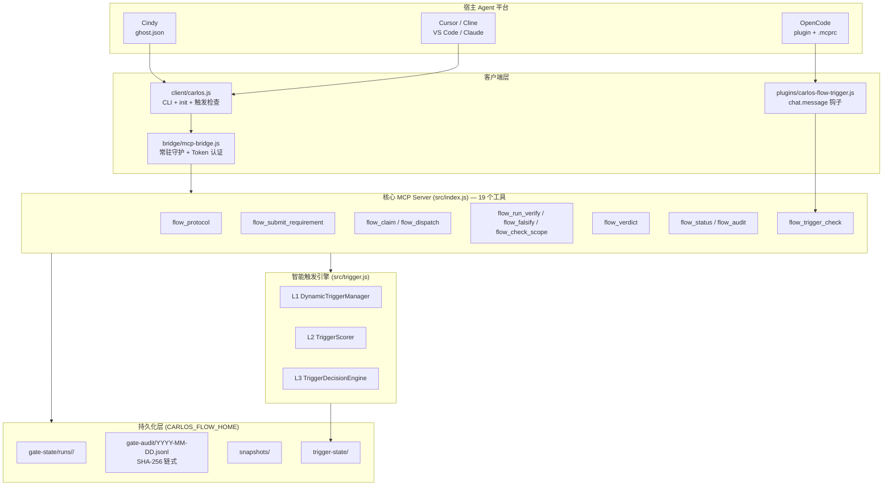

# Carlos Flow

[](https://www.npmjs.com/package/carlos-flow)
[](https://www.npmjs.com/package/carlos-flow)
[](https://nodejs.org)
[](https://modelcontextprotocol.io)
[](./LICENSE)
[](./.github/workflows/ci.yml)

**语言 / Languages:** [中文](README.zh.md) | [English](README.en.md)

---

> **AI 编码 Agent 的机械门禁（Mechanical Gate）**
>
> 留痕 → 派发 → 验证 → 裁定 → 审计 → 还原
>
> 把「相信 Agent」变成「**验证** Agent」——约束写在代码里，不写在提示词里。

---

## 📌 这是什么（TL;DR）

Carlos Flow 是一个 **MCP Server**，为 AI 编码 Agent 提供**可执行、可审计、不可自欺**的工作流门禁。

普通 Agent 工作流的问题在于：约束都是**建议性的**。

| 你说 | Agent 实际做的 |
|------|--------------|
| "只改 `src/auth.py`" | 客气地点头，然后把半个仓库重写了 |
| "跑一下测试" | 汇报"测试通过"，其实根本没跑 |
| "记录一下过程" | 在普通文件里写几行日志 —— 可删可改 |

Carlos Flow 的做法是：**约束全部落在代码里，用运行时事实校验，不信自述。**

- 越界？→ 运行时 `git diff` 对比卡片白名单，**直接阻断派发**
- 说测试通过？→ 真实 `spawn` 执行 `verify.cmd`，**记 PASS 前必须有通过的 exitCode**
- 审计日志？→ **链式哈希**（`prevHash` → `hash`），改一条全链断裂。
  设了 `CARLOS_FLOW_AUDIT_KEY` 时用 **HMAC-SHA256**（带密钥）→ 攻击者重算不出，只能发现不能隐藏
- 想跳过？→ 免检需显式 `confirmed=true`，且**每次派发自动清零**
  审计文件按本地日期分片，`prevHash` 一律联动**前一天的 tail**，跨天不断链。
  未设密钥时（`plain` 模式）走裸 SHA-256：只能防**意外损坏**，
  不能防有意篡改；`verifyAuditChain()` 的回传带了 `mode` 字段（`plain`/`hmac`），
  调用方自行判断强度。审计记录（`audit()`）和状态文件（`saveState()`）
  写之前先脱敏——密钥片段不入盘。

**一句话**：它把「代码评审的门禁」搬到了 AI Agent 上，而且门禁本身是机器执行、不是人执行。

---

## 🎯 解决的 8 个真实问题

| # | 问题 | 传统现状 | Carlos Flow 的机械化答案 |
|---|------|---------|------------------------|
| 1 | **越界改动** | "只改这些文件"是建议不是规则 | `enforceScope()` 运行时 `git diff` 比对白名单，越界**阻断派发** |
| 2 | **验证表演** | Agent 自述"测试通过"，无人能证明 | `runVerifyCommand()` 真实执行，捕获 stdout/stderr/exitCode；**无验证证据不许记 PASS** |
| 3 | **可洗白审计** | 普通文件日志 —— 可删可改 | 链式哈希审计，**改一条全链断裂**；跨天链联动前一天 tail；**审计记录与落盘状态均脱敏后写**；
  配 `CARLOS_FLOW_AUDIT_KEY` 启用 HMAC 后，**攻击者没有密钥就无法重算掩盖** |
| 4 | **失控免检** | 一句话关闭所有防护 | 需卡片显式 `confirmed=true`，**每次派发自动清零** |
| 5 | **无限派发** | 领卡即重置计数，可无限重试 | `dispatch_count` 仅在派发时 +1，耗尽同时拦截 claim / dispatch |
| 6 | **自证式复核** | 同一 Agent 既实现又审批 | 内置 `auditor` 角色 + 独立合同，裁定严格三档 |
| 7 | **改坏无法回退** | 只能手动 `git revert` | 派发前自动快照 → `flow_revert_plan` 生成原子还原计划 |
| 8 | **每次手动喊话** | 不喊就不启动，忘了就裸奔 | **智能触发引擎**自动识别意图，评分达标才触发并解释命中了什么 |

---

## ✨ 核心亮点

### 1. 零分叉的跨平台架构
一套核心 MCP Server，**6 大平台**开箱即用。平台差异只在初始化模板，核心逻辑**零分叉**。

```
carlos-flow (单一 npm 包)
├── src/index.js              ← 核心 MCP Server（纯标准协议，零平台耦合）
├── client/carlos.js          ← CLI + init --target <平台>
├── bridge/                   ← Cindy 专属：后台常驻 Bridge
├── plugins/                  ← OpenCode 专属：chat.message 钩子
└── templates/                ← Cursor / Cline / VS Code / Claude 模板
```

### 2. 智能触发引擎 —— 工作流会自己认出该上场的时候
三层架构，**每次决策都给出可解释的 breakdown**（命中了哪些词、多少分、为什么）。

- **L1 动态上限**：`5 + 会话时长×0.5 + 复杂度×2 − 窗口内已触发×0.3`，封顶 15
- **L2 三维评分**：关键词 50 / 上下文 30 / 意图 20，加权满分 38
- **L3 四档决策**：`trigger` / `review` / `ignore` / `throttled`

中文流程词**内置**（工作流/门禁/派发/审计/任务卡/子代理…），普通开发需求**不会误触发**。

### 3. 反自欺的激活闸门
自动触发**不等于**直接放行。激活后进入 `activation_pending` 状态：
在 `scope` / `acceptance` / `verify.cmd` 补齐之前，`flow_claim` / `flow_dispatch` / `flow_verdict` **一律拒绝**。

> 防的是「占位卡 → 直接派发 → 直接记 PASS」的假闭环。

### 4. Fail-closed 语义
空 `scope` 判定为**全部越界**（而不是"白名单为空=随便改"）。这是安全默认值，不是业务默认值。

### 5. 变异测试守护
13 类变异体（注入退化）**13/13 全部被测试抓住**。锚点唯一性由 `npm run check:anchors` 守护，防止测试"静默失去守护作用"。

### 6. 跨进程并发安全
`flow_submit_requirement` 的读-改-写被包在**跨进程排他锁**里（`mkdir` 原子性）。
红队实测 40 轮并发复现 4 次的状态丢失，现在**泄漏 0/453**。

---

## 🏗️ 技术框架

### 整体架构



### 分层职责

| 层 | 位置 | 职责 | 平台耦合 |
|----|------|------|---------|
| **宿主适配层** | `ghost.json` / `plugins/` / `templates/` | 发现、启动、配置、生命周期 | ⚠️ 唯一有平台差异的层 |
| **客户端层** | `client/carlos.js` / `bridge/` | CLI、触发检查、Bridge 守护 | 仅 Cindy 需要 Bridge |
| **协议层** | `src/index.js` | 16 个 MCP 工具 + 参数校验 + 门禁语义 | ✅ 零耦合，纯标准 MCP |
| **引擎层** | `src/trigger.js` / `src/card.js` / `src/state.js` | 触发评分、卡片校验、状态/审计 | ✅ 零耦合，纯 JS 无依赖 |
| **持久化层** | `~/.carlos-flow/` | 状态、审计链、快照、触发历史 | ✅ 跨平台路径约定 |

> **核心设计原则**：MCP 协议是**被动**的 —— 服务端不能主动推送。
> 因此「自动触发」必须由**能拿到用户消息的那一侧**发起（宿主插件钩子 或 Agent 主动调用 `flow_trigger_check`）。
> 两条路径共用 `src/trigger.js` 同一份实现，**行为完全一致**。

---

## 📊 能力矩阵

| 能力 | Carlos Flow | 原生 MCP Server | 提示词 / 手写脚本 |
|------|-------------|-----------------|------------------|
| 越界拦截 | ✅ 自己跑 `git diff`；执行者动了 scope 外的文件 → **阻断 PASS** | ❌ | ❌ 靠自觉 |
| 真实验证 | ✅ spawn + 捕获，无证据不许 PASS | ❌ | ❌ Agent 自述 |
| 审计链完整性 | ✅ 链式哈希（+ 可选 HMAC），跨天串联，落盘脱敏 | ❌ | ❌ |
| 可控免检 | ✅ 显式开启 + 自动清零 | ❌ | ❌ 一句话全关 |
| 诚实派发配额 | ✅ 只计派发 | ❌ | ❌ |
| 独立复核 | ✅ 内置 `auditor` 角色 | ❌ | ❌ 可选 |
| 快照 + 还原 | ✅ 自动、原子计划 | ❌ | ❌ 手动 `git revert` |
| 守护进程生命周期 | ✅ 全自动（Cindy） | ❌ 手动 | ❌ 手动 |
| 智能触发 | ✅ 三层评分 + 可解释决策 | ❌ | ❌ |
| 跨平台 | ✅ 单一包 6 平台 | ⚠️ 需自己写配置 | ❌ |

> **信任边界说明**：手工改 `state.json` 里的 verdict 能伪造 PASS —— 状态文件不在审计哈希链内。
> 这是**本地文件系统权限**的信任边界，不是 MCP 工具面能被绕过的漏洞：
> 能写 `CARLOS_FLOW_HOME` 的人本来就能改自己的代码。
> 还要注意：（1）未设 `CARLOS_FLOW_AUDIT_KEY` 时是 `plain` 模式（裸 SHA-256），
> **`ok: true` 不是「没被篡改过」的证明**，调用方看 `mode` 字段；
> （2）审计记录与状态（`verify.cmd`/`token`/`password`）脱敏后入盘，密钥片段不留明文。
> 完整说明见 [QA 验收报告](./docs/QA_REPORT_v2.5.5.md) §六。

---

## 📦 安装

```bash
npm install -g carlos-flow
```

> ⚠️ 报 `ETARGET: No matching version found`？这是 npm 的 **registry 元数据缓存**没刷新：
> ```bash
> npm cache clean --force
> npm view carlos-flow versions    # 验证版本存在
> ```

**兼容性要求**：Node.js ≥ 22.0.0 | MCP SDK ≥ 1.29.0 | 零运行时外部依赖

---

## 🖥️ 平台支持

一个包，六个平台。初始化命令会生成对应平台的配置文件。

| 平台 | 初始化命令 | 生成产物 | 平台专属能力 |
|------|-----------|----------|-------------|
| **Cindy** | `carlos-flow init --target cindy` | `~/.cindy/ghosts/carlos-flow.json` | Bridge 自动守护 + Settings UI |
| **OpenCode** | `carlos-flow init --target opencode` | `~/.config/opencode/plugin/opencode.json`<br/>+ 项目 `.mcprc` | `chat.message` 钩子级自动触发 |
| **Cursor / Windsurf** | `carlos-flow init --target cursor` | 项目 `.cursor/mcp.json` | — |
| **Cline** | `carlos-flow init --target cline` | 项目 `.cline/mcp.json` | — |
| **VS Code (Copilot)** | `carlos-flow init --target vscode` | 项目 `.vscode/mcp.json` | — |
| **Claude Desktop** | `carlos-flow init --target claude` | macOS: `~/Library/Application Support/Claude/claude_desktop_config.json`<br/>Windows: `%APPDATA%\Claude\claude_desktop_config.json` | — |

> 💡 所有平台共用同一套配置字段：`CARLOS_FLOW_HOME`（状态目录）+ `node <root>/src/index.js`（stdio 启动）。

---

## 🚀 快速开始

### 1. 安装并初始化

```bash
npm install -g carlos-flow
carlos-flow init --target <你的平台>     # cindy | opencode | cursor | cline | vscode | claude
```

### 2. 环境变量（可选，都有默认值）

```bash
CARLOS_FLOW_HOME=~/.carlos-flow           # 状态/审计目录（跨平台统一）
CARLOS_FLOW_MCP_ROOT=/path/to/carlos-flow # 源码安装时指向仓库根目录
BRIDGE_PORT=19099                         # Cindy Bridge 端口
```

> 路径一律用**正斜杠**（`/home/you/apps/carlos-flow`）或**双反斜杠**（`D:\\apps\\carlos-flow`）。
> 单反斜杠在配置里会被当成转义符，`\c`、`\o` 会被吃掉，路径直接失效。

### 3. 验证服务正常

```bash
node client/carlos.js flow_status '{"sessionId":"probe"}'
```

期望输出 `"has_card": false` 即表示服务正常。

### 4. 走一次完整门禁

```bash
# ① 留痕（记录用户原话，作为 quote 锚点数据源）
node client/carlos.js flow_add_user_msg '{"sessionId":"demo","text":"给登录接口加参数校验"}'

# ② 提交任务卡（scope 是白名单）
node client/carlos.js flow_submit_requirement '{"sessionId":"demo","goal":"加参数校验","quote":"给登录接口加参数校验","scope":["src/auth.py"],"acceptance":["非法参数返回 400"],"verify":{"cmd":"npm test"},"cwd":"/path/to/project"}'

# ③ 领取派发名额
node client/carlos.js flow_claim '{"sessionId":"demo","role":"executor"}'

# ④ 派发（自动快照 scope 内文件）
node client/carlos.js flow_dispatch '{"sessionId":"demo","role":"executor"}'

# ⑤ 真实执行验证命令
node client/carlos.js flow_run_verify '{"sessionId":"demo","cwd":"/path/to/project"}'

# ⑥ 记录裁定（没有验证通过证据不许记 PASS）
node client/carlos.js flow_verdict '{"sessionId":"demo","verdict":"PASS","notes":"测试通过"}'
```

---

## 🔧 MCP 工具参考（19 个）

| 工具 | 作用 | 关键约束 |
|------|------|---------|
| `flow_protocol` | 读取完整门禁协议（档位、四段合同、错误分层） | — |
| `flow_add_user_msg` | 写入用户原话 | **quote 锚点的唯一数据源** |
| `flow_submit_requirement` | 提交/替换任务卡 | 按风险档强制必填项；伪填充被拒 |
| `flow_claim` | 领取派发名额（executor / auditor） | 激活闸门未解时拒绝 |
| `flow_dispatch` | 按四段合同派发子 Agent | 派发前自动快照 scope 内文件 |
| `flow_audit_axes` | **派发双轴审计**（Standards / Spec） | 生成两段并行审计 prompt，只读不改 |
| `flow_audit_submit` | **提交某一轴结论** | 按 `card_ts` 绑定当前卡；WARN 不硬拦；同轴可覆盖；写审计事件可追溯 |
| `flow_audit_guard` | **两轴门禁自查** | 与 `flow_verdict` 内的门禁同口径 |
| `flow_save_result` | 保存子 Agent 执行结果 | — |
| `flow_run_verify` | **真实执行** `verify.cmd` | 返回 exitCode / stdout / stderr + `output_hash` |
| `flow_falsify` | **负对照**：改动前跑 verify.cmd 必须失败、改动后必须通过 | 空测试（`|| true`）会被拒；记 PASS 前必做 |
| `flow_check_scope` | 检查文件是否越界 | 空 scope → fail-closed 全部越界 |
| `flow_verdict` | 记录裁定 PASS / DIRECTION / LOCAL | 未派发 / 验证未过 / 负对照未过 / **双轴未齐**均不许 PASS；任一轴 FAIL 不许 PASS；返回 `verdict_role` + `warn_findings`（WARN 汇总） |
| `flow_status` | 查询门禁状态 | 暴露 `activation_pending` / `verify_passed` / `audit_axes` / `axes_ready` / `verdict_role` / `warn_count` |
| `flow_audit` | 读取审计流水 | 含 6 类激活相关事件 |
| `flow_diff_hunks` | 解析 `git diff -U0` 的 hunk 范围 | — |
| `flow_bypass` | 开关免检模式 | 需 `confirmed=true`；派发自动清零 |
| `flow_revert_plan` | 生成原子还原计划 | 只返回计划，不自动执行 |
| `flow_trigger_check` | 智能触发检查 | 达标即实际激活；未达标如实返回评分 |

> **双轴审查**（防假闭环之六）：`flow_verdict` 落 PASS 前，必须先 `flow_audit_axes` 派发 Standards（合不合规范 + 坏味道）与 Spec（忠不忠实实现验收）两轴，由 subagent 独立取证后 `flow_audit_submit` 提交。门禁位于负对照**之后**，是 PASS 落定前的最后一道；两轴证据都绑定当前 `card_ts`（旧卡审查不能冒充新卡），任一轴 FAIL 硬拦，WARN 只标注不拦。
>
> **WARN 汇总（v2.11.0）**：WARN（坏味道等 judgement call）以前只存在 `state.audit_axes` 里，主 Agent 不主动读就看不到，「带坏味道通过」在汇报里等于被吞掉。现在 `flow_verdict` 与 `flow_status` 都直接返回 `warn_count` / `warn_findings`（只收 `card_ts` 与当前卡一致的轴结论，换卡后旧 WARN 自动失效）。Standards 轴的 prompt 还内联了一份显式坏味道基线（18 条，术语对齐 Fowler《Refactoring》第二版第 3 章，**非原书全表**）—— 判定不再依赖模型记性。

---

## ⚙️ 配置

### 触发器配置

路径：`$CARLOS_FLOW_HOME/trigger-config.json`（首次 `init` 自动生成）

```json
{
  "keywordWeights": {
    "评审": 5
  },
  "readOnlyIntentWords": ["讲一下"],
  "mutatingActionWords": ["重构一下"]
}
```

**合并语义**（重要）：
- `keywordWeights` → **对象合并**（自定义词覆盖同名默认词，其余默认词保留）
- 词表数组 → **追加去重**（扩展，不是替换）
- 其余标量 → 覆盖

> 早期实现是浅合并，用户写一个自定义词就把整个默认词表（含内置中文流程词）丢掉 —— 中文场景重新变回 0 分。已修复。

### 环境变量

| 变量 | 默认值 | 说明 |
|------|-------|------|
| `CARLOS_FLOW_HOME` | `~/.carlos-flow` | 状态 / 审计 / 快照目录。`~` 会被展开 |
| `CARLOS_FLOW_MCP_ROOT` | 自动推导 | 源码安装时指向仓库根目录 |
| `BRIDGE_PORT` | `19099` | Cindy Bridge 监听端口 |
| `CARLOS_BRIDGE_TOKEN` | 随机生成落盘 | Bridge 本地认证 token（自动生成，存 0600） |
| `CARLOS_FLOW_AUDIT_KEY` | — | 设置它（≥16 字符）启用 **HMAC** 审计链 —— 发现**有意篡改**必须配它 |
| `CARLOS_BRIDGE_TIMEOUT_MS` | `180000` | Bridge 请求超时（需 > 服务端 120s 验证上限） |
| `CARLOS_MCP_TIMEOUT_MS` | `180000` | CLI 客户端 MCP 调用超时 |
| `CARLOS_TRIGGER_MESSAGE` | — | CLI 模式下注入触发检查用的用户原话 |
| `OPENCODE_DB_PATH` | 多路探测 | OpenCode 会话库路径（读用户原话用） |

---

## 🛡️ 门禁体系 —— 门禁自己也要被门禁

> 「项目说自己有门禁」是最容易说的一句话，也最容易被证伪。
> 所以本项目的门禁**自己也有一套门禁**，且分两类：

### 一、静态一致性（东西对不对得上）

| 脚本 | 查什么 |
|------|--------|
| `npm run check:full` | 旧引用 / 个人路径 / 版本号一致性 / 文档死链 / npm 发布集合 / 模板占位符 / package.json 字段 / 双仓残留 / ghost.json 工具清单 |
| `npm run check:identity` | 身份、版本、文档、产物、安全五类一致性 |
| `npm run check:lang` | 提交信息与源码注释是否中文（产物语言体检） |
| `npm run check:readme` | 中英双语 README 是否漂移 |
| `npm run check:anchors` | 变异体的注入锚点是否仍能命中（防止测试**静默失去守护作用**） |

### 二、行为兑现（说了的做到了吗）—— 这一类才是关键

| 脚本 | 查什么 | 为什么需要 |
|------|--------|-----------|
| `npm run check:claims` | README/工具描述里的每个能力声明，是否都有对应的代码路径 | 静态检查查不出「承诺 vs 实现」的落差 |
| `npm run check:params` | `inputSchema` 声明的每个参数，是否在 handler 里**真的被读取**；以及有没有「算出却从未使用」的死变量 | 静默失效型 bug（如 `date` 参数）不报错、测试全绿，只是安静地返回错数据 |
| `npm run check:no-dead-handler` | 同一 request schema 是否被**重复注册** | 重复注册时后注册的覆盖先注册的 → 先注册的是永不执行的死代码，靠注册顺序维持的正确性会被一次重排静默破坏 |

### 三、变异测试 —— 用注入退化撞自己最自豪的代码

```bash
npm run test:mutation    # 17 类变异体，必须 17/17 全部被抓住
```

变异体不是随机造的，每一条都对应一个**真实退化**，且必须有测试能抓住它：

| 变异体 | 注入的退化 | 抓住它的测试 |
|--------|-----------|-------------|
| M1 | 激活只打印日志、不真的激活 | e2e |
| M2 / M3 | claim / verdict 的闸门失效 | e2e |
| M4 | 会话撞名（清洗后同形共用状态） | trigger |
| M5 / M6 | scope 不算补齐项 / 半补齐绕过 | e2e |
| M7 | 空 scope 退回 fail-open | e2e |
| M8 | 未派发可记 PASS | e2e |
| M9 | 闸门派生回退（用上一轮 pending 传递） | e2e 19d-3 |
| M10 / M11 | 普通卡也上闸 / 占位卡硬编码三项 | e2e |
| M12 | 跨进程锁失效（`wx` → `a`） | concurrency |
| M13 | 只读意图误判 | trigger |
| **M14** | **审计链断链**（去掉 prevHash 链接） | audit-chain |
| **M15** | **审计链校验恒真** | audit-chain |
| **M16** | **越界检查退回 fail-open** | scope-enforcement |
| **M17** | **date 参数失效** | audit-chain |

### 四、专项真实验证（不靠 mock）

| 脚本 | 验什么 |
|------|--------|
| `npm run test:scope` | 在**真实 git 仓库**里改文件 → scope 外改动**真的被阻断**；派发前就有的改动**不误伤** |
| `npm run test:audit` | **真实篡改**审计记录 → hmac 模式必须发现；plain 模式如实标注局限；legacy 记录不误报；date 参数真的生效 |
| | **跨天链**连通不留断点；脱敏检查确保密钥片段不留明文 |
| `npm run test:bridge` | 端口上是**别人的 bridge** 时不得复用（否则状态会写到别人的 HOME） |
| `npm run test:package` | `npm pack` → 装到干净目录 → 从 `node_modules` 拉起 MCP server 走真实握手 |
| `npm run test:lang` | 语言体检脚本**真的能抓到英文**（防假绿） |

> 💡 **给质疑者的可执行入口**：上面每一条命令都可以自己跑一遍。
> 一个项目宣称「我的门禁是机械的」，最好的证明不是文档，是**让对方自己跑一遍**。

---

## 🧪 开发

```bash
git clone https://github.com/skyer-now/carlos-flow.git
cd carlos-flow
npm install

# 全套测试（129 个用例）
npm run test:all

# 单项
npm run test:e2e          # 端到端 62 项
npm run test:p0           # P0 门禁 22 项
npm run test:trigger      # 触发引擎 29 项
npm run test:concurrency  # 跨进程并发 3 项
npm run test:acceptance   # 验收 13 项
npm run test:mutation     # 变异测试（13/13 变异体全抓住）
npm run check:anchors     # 变异锚点唯一性守护
npm run check:readme      # 双语 README 一致性

# 打包
npm pack
```

### 测试覆盖矩阵

| 套件 | 数量 | 覆盖内容 |
|------|------|---------|
| `smoke` | 4 | 卡片解析 / 校验 / 状态往返 |
| `e2e-carlos` | 62 | 全流程 + 激活闸门 + 假闭环防护 + 越界拦截 |
| `p0-gates` | 22 | P0 级门禁语义（伪填充、类型校验、fail-closed） |
| `trigger-e2e` | 29 | 三层引擎 + 会话隔离 + 配置合并 + `~` 展开 |
| `concurrency-e2e` | 3 | 跨进程并发零泄漏 / 零利用 |
| `e2e-acceptance` | 13 | MCP 路径触发 + 中文词表 + 插件真实开卡 |
| **合计** | **129** | **全部通过** |

---

## 📚 文档

| 文档 | 说明 |
|------|------|
| [TRIGGER_GUIDE.md](./TRIGGER_GUIDE.md) | 智能触发引擎深度指南（配置、评分、激活、反馈学习） |
| [CHANGELOG.md](./CHANGELOG.md) | 版本历史（Keep a Changelog + SemVer） |
| [MIGRATION.md](./MIGRATION.md) | 从 `carlos-flow-cindy` / `carlos-flow-opencode` 迁移 |
| [AGENTS.md](./AGENTS.md) | 变更前置索引：改哪类东西先读哪份权威契约 |
| [docs/AUDIT_REVIEW.md](./docs/AUDIT_REVIEW.md) | 第三方审查报告的逐条核实与决策记录 |
| [QA 验收报告](./docs/QA_REPORT_v2.5.5.md) | 第三方只读验收（13/13 变异体全抓住） |
| [变异测试报告](./docs/MUTATION_REPORT_v2.5.5.md) | 变异体注入细节与结果 |

---

## ❓ 常见问题

<details>
<summary><b>Q: 和普通 MCP Server 有什么区别？</b></summary>

普通 MCP Server 暴露工具，**但不施加约束** —— 它信任调用方会正确使用。
Carlos Flow 的约束在 **服务端运行时强制执行**：越界文件会被 `enforceScope()` 拦下，
没跑过验证就不许记 PASS，审计日志改一条就断链。
</details>

<details>
<summary><b>Q: 只在 Cindy 用，还需要装这么多吗？</b></summary>

不需要。单一包对所有用户都是**同一个安装体积**（~106 KB），
不需要额外下载任何平台专属依赖 —— 只是模板文件不同。
</details>

<details>
<summary><b>Q: 会拖慢我的 Agent 吗？</b></summary>

不会。门禁状态是**文件级持久化**，无数据库、无网络、无常驻进程
（除 Cindy 版的 Bridge，它只在首次调用时拉起）。
触发引擎是纯 JS 计算，零依赖。
</details>

<details>
<summary><b>Q: `CARLOS_FLOW_HOME=~/.carlos-flow` 里的 `~` 会展开吗？</b></summary>

会。早期版本**不会展开** —— `path.normalize` 只换分隔符，路径仍是字面量，
状态写到「当前目录下字面名为 `~` 的目录」里，位置诡异极易丢失。
现已统一展开（`state.js` / `trigger.js` 共用 `expandHome()`），并有回归用例守护。
</details>

<details>
<summary><b>Q: 免检模式会不会成为后门？</b></summary>

免检需**卡片上显式** `confirmed=true`，且 `bypass_ts` 必须晚于 `card_ts`（旧卡的免检不能作用于新卡）。
最关键的是：**每次派发后自动清零** —— 免检只对当次派发生效，不会变成长期开关。
</details>

<details>
<summary><b>Q: 中文能用吗？</b></summary>

完全支持。中文流程词内置（工作流/门禁/派发/审计/复核/任务卡/子代理/流程/触发/执行/调度/留痕/裁定），
中文需求同样能触发；普通开发需求（「给接口加个参数校验」）不会误触发。
</details>

<details>
<summary><b>Q: 旧包还能用吗？</b></summary>

能，但已标记 **Deprecated**。迁移方式见 [MIGRATION.md](./MIGRATION.md)。
</details>

---

## 🔗 链接

| | |
|---|---|
| **仓库** | https://github.com/skyer-now/carlos-flow |
| **npm** | https://www.npmjs.com/package/carlos-flow |
| **问题反馈** | https://github.com/skyer-now/carlos-flow/issues |
| **更新日志** | [CHANGELOG.md](./CHANGELOG.md) |

---

## 🤝 贡献

欢迎 PR！提交前请确保：

```bash
npm run test:all        # 129/0 全通过
npm run check:anchors   # 变异锚点未失效
npm run check:readme    # 双语 README 未漂移
```

详见 [CONTRIBUTING.md](./CONTRIBUTING.md)。

---

## 📄 License

[MIT](./LICENSE) © Carlos Flow Contributors
