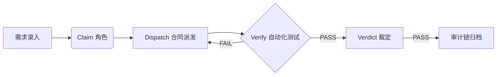

# Carlos-Flow

[](https://github.com/skyer-now/carlos-flow)
[](https://www.npmjs.com/package/carlos-flow)
[](LICENSE)

**Carlos-Flow** 是一个面向 AI 智能体的安全审计工作流引擎，通过机械化的门禁（Claim-Dispatch-Audit-Verdict）确保每一行 AI 生成的代码都经过合规验证。

---

## ⚡️ 核心功能：向导模式 (Wizard Mode)

对于非技术用户，Carlos-Flow 提供全新的**向导模式**，通过“自动组队”与“风险分级”机制，将复杂的审计流程转化为自动化执行：

- **自动化协作**：根据任务目标，系统自动完成组队（开发/测试/审核）与任务派发。
- **动态风险评估**：基于 Tier 自动匹配门禁强度，无需手动配置。
- **全流程陪伴**：任务执行过程全透明，实时反馈测试结果与审计意见。

> 开启命令：`carlos flow_mode --mode guide`

---

## 🛡️ 审计门禁链 (Mechanism)

Carlos-Flow 的安全性基于严密的流程节点：



---

## 🚀 快速上手

```bash
# 全局安装
npm install -g carlos-flow

# 初始化工作流
carlos init
```

---

## ❓ 常见问题 (FAQ)

**Q: 向导模式能绕过门禁吗？**
A: **绝对不会**。向导模式仅优化了交互和工作流编排，底层的所有安全门禁（双轴审计、指纹校验）强制执行，确保生产环境安全。

**Q: 如何获取任务的审计报告？**
A: 每项任务执行完毕后，审计记录会自动留痕，你可以使用 `carlos flow_audit` 查看流水，或在 `.carlos-flow/gate-state/` 目录下获取归档文件。

---

## 📝 贡献说明
欢迎提交 Issues 或 Pull Requests。在提交前，请确保通过本地 CI 检查：`npm run test:all`。
