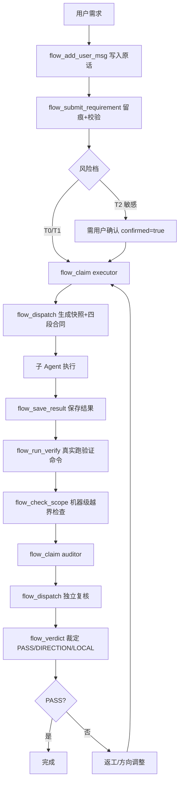

# Carlos 工作流 - Cindy 适配版

> **Mechanical Gatekeeping MCP**: Record → Dispatch → Verdict → Audit → Snapshot Restore  
> Auto-manages Bridge daemon; first call ~3-5s, subsequent ~1s

---

## 🎯 为什么选择 Carlos Flow？| Why Carlos Flow?

### 😣 痛点 | Pain Points

| 场景 | 传统做法的问题 | Carlos Flow 解决 |
|------|---------------|------------------|
| **AI 改代码越界** | 只能靠提示词约束，无法机器级拦截 | `enforceScope()` 运行时强制校验 git diff，越界即阻断 |
| **验证命令不跑** | AI 说"跑过了"实则没跑，无证据 | `runVerifyCommand()` 真实执行 verify.cmd，捕获 stdout/stderr/exit code |
| **审计可篡改** | 日志在内存/普通文件，事后可删改 | SHA-256 审计链（prevHash/hash），防篡改可数学验证 |
| **免检模式失控** | 一句话"免检"就绕过所有门禁 | `isBypassed()` 需显式卡片确认，派发自动清零，不可隐式触发 |
| **派发次数作弊** | 领卡即重置计数，无限刷额度 | `dispatch_count` 仅在 `flow_dispatch` 时 +1，claim 不计数 |
| **Bridge 手动管理** | 必须先起后台进程，易忘、易挂、端口冲突 | 首次调用自动拉起、健康检查、Token 认证、限流、超时控制 |
| **敏感信息泄露** | Token、路径硬编码在配置/代码 | Cindy 加密保险库存储，代码零明文 |
| **复核流程缺失** | 只有 executor，无独立 auditor | 内置 auditor 角色，四段合同强制独立复核，裁定三档 |

---

## 🌟 核心亮点 | Core Highlights

| # | 能力 | 关键技术点 |
|---|------|------------|
| 1️⃣ | **真实验证** | `flow_run_verify` + `runVerifyCommand()` 真实执行 verify.cmd，返回 `{exitCode, stdout, stderr, ok}` |
| 2️⃣ | **越界拦截** | `flow_check_scope` + `enforceScope()` 机器级 git diff 对比 scope 白名单，越界文件即时报错 |
| 3️⃣ | **防篡改审计** | `verifyAuditChain()` SHA-256 链式哈希，每条记录含 `prevHash`，单条篡改即断链 |
| 4️⃣ | **可控免检** | `flow_bypass` + `isBypassed()` 显式开关，需卡片 `confirmed=true`，新派发自动清零 |
| 5️⃣ | **精准计数** | `dispatch_count` 仅 dispatch 叠加，claim/verdict 不计数，配额真实生效 |
| 6️⃣ | **快照还原** | `flow_dispatch` 自动快照 scope 文件 → `flow_revert_plan` 生成原子还原计划 |

---

## 🛠️ 14 个工具完整列表 | 14 Tools

### 📝 卡片与留痕 | Card & Record
| 工具 | 作用 |
|------|------|
| `flow_protocol` | 读取完整协议（路由档位 T0/T1/T2、四段合同、报告规格、错误分层、审计事件、免检触发词、卡片模板） |
| `flow_add_user_msg` | 写入用户原话（锚点数据源，供卡片 quote 校验） |
| `flow_submit_requirement` | 提交任务卡（锚点校验、scope 存在性、敏感路径确认、风险档自动判定） |

### 🚀 派发与执行 | Dispatch & Execution
| 工具 | 作用 |
|------|------|
| `flow_claim` | 领取派发名额（executor/auditor），返回四段合同 prompt，消耗 dispatch 配额 |
| `flow_dispatch` | 生成派发 prompt + 自动文件快照（用于事后还原），可选 `run=true` 直接拉起子进程 |
| `flow_run_verify` | **NEW** 真实执行卡片 `verify.cmd`，返回结构化结果（exitCode/stdout/stderr/ok） |
| `flow_check_scope` | **NEW** 机器级 scope 越界校验，传入变更文件列表，返回 `{ok, violations[]}` |

### ⚖️ 裁定与状态 | Verdict & Status
| 工具 | 作用 |
|------|------|
| `flow_verdict` | 记录裁定（PASS/DIRECTION/LOCAL），仅 PASS 置 `completed_ok=true` |
| `flow_status` | 查询门禁状态（卡片、风险档、派发次数/上限、裁定、过期、免检模式、时间戳） |

### 🔍 审计与取证 | Audit & Forensics
| 工具 | 作用 |
|------|------|
| `flow_audit` | 读取审计流水（按类型/时间/会话筛选） |
| `flow_diff_hunks` | git diff hunk 级分析（定位到函数/行，供 auditor 取证） |
| `verifyAuditChain` | 校验审计链完整性（SHA-256 链式哈希），返回 `{ok, brokenAt?, detail}` |

### 🛡️ 免检与还原 | Bypass & Restore
| 工具 | 作用 |
|------|------|
| `flow_bypass` | 免检开关（需卡片 `confirmed=true`，显式开启/关闭，派发自动清零） |
| `flow_revert_plan` | 基于快照生成还原计划（按时间倒序，原子操作，可逐条执行） |

---

## 🔄 典型工作流 | Typical Workflow



---

## 📦 安装 | Installation

### 方式一：Cindy 插件市场（推荐）| Via Cindy Plugin Market (Recommended)

1. 打开 Cindy → 设置 → 插件 → 浏览市场
2. 搜索 `carlos-flow` 点击安装
3. 在插件设置页填写环境变量（见下表）
4. 完全退出 Cindy 重启，输入 `/门禁` 或说"走门禁"

### 方式二：本地源码安装 | Local Source Install

```bash
# 1. 克隆仓库
git clone https://github.com/skyer-now/carlos-flow-cindy.git
cd carlos-flow-cindy

# 2. 安装依赖
npm install

# 3. 配置环境变量
cp .env.example .env
# 编辑 .env 填入实际路径

# 4. 验证安装
npm test          # 冒烟测试（隔离临时目录）
npm run test:e2e  # 端到端测试（需配置好环境变量）
```

---

## ⚙️ 环境变量 | Environment Variables

| 变量 | 必填 | Required | 说明 | Description | 示例 |
|------|------|----------|------|-------------|------|
| `CARLOS_FLOW_MCP_ROOT` | ✅ | ✅ | MCP 源码根目录（含 `src/` `bridge/` `client/`） | MCP source root (contains `src/` `bridge/` `client/`) | `D:/cindy/carlos-flow-mcp` |
| `CARLOS_FLOW_HOME` | ✅ | ✅ | 状态/审计/快照根目录 | State/audit/snapshot root | `~/carlos-flow` |
| `BRIDGE_PORT` | ❌ | ❌ | Bridge 监听端口（默认 19099） | Bridge listen port (default 19099) | `19099` |
| `REA_MCP_ROOT` | ❌ | ❌ | rea MCP 源码根目录 | rea MCP source root | `D:/dev-env/rea` |
| `GHIDRA_HOME` | ❌ | ❌ | Ghidra 安装目录 | Ghidra install dir | `D:/dev-env/ghidra/ghidra_12.1.4_PUBLIC` |
| `JAVA_HOME` | ❌ | ❌ | JDK 21 安装目录 | JDK 21 install dir | `D:/dev-env/jdk-21.0.12.1+1` |
| `NODE_PATH` | ❌ | ❌ | Node.js 可执行文件路径（默认 `node`） | Node.js executable path (default `node`) | `node` |

> **提示 | Note**：Cindy 插件设置页修改环境变量后需**完全退出 Cindy 重启**生效。

---

## 🏗️ 架构对比 | Architecture Comparison

| 维度 | Cindy 版 (本仓库) | OpenCode 版 | 原生 MCP Server |
|------|------------------|-------------|-----------------|
| 传输协议 | TCP Bridge (127.0.0.1:19099) | 纯 stdio | 纯 stdio |
| 后台管理 | 自动（首次调用拉起 Bridge） | OpenCode 托管 | 手动/外部托管 |
| 配置方式 | 插件设置页 + 环境变量 | `.mcprc` / `opencode.json` | 环境变量/配置文件 |
| 密钥存储 | **Cindy 加密保险库** | 明文配置文件 | 用户自行管理 |
| rea 集成 | 内置 `client/rea.js` | 另注册 MCP | 需单独部署 |
| 适用场景 | **Cindy App 用户** | **OpenCode 2.2.2+ 用户** | 通用 MCP 客户端 |

---

## 📁 目录结构 | Directory Structure

```
carlos-flow-cindy/
├── src/                    # MCP Server 核心（stdio 传输）
│   ├── index.js            # 入口：注册 14 个工具
│   ├── protocol.js         # 协议定义（路由表/合同/错误层/状态 schema）
│   ├── card.js             # 任务卡解析/修复/校验
│   ├── state.js            # 状态持久化/审计链/用户消息源
│   └── dispatch.js         # 四段合同/文件快照/验证执行/越界校验/结果保存
├── bridge/                 # TCP Bridge（安全桥接层）
│   ├── mcp-bridge.js       # 监听 127.0.0.1:19099，Token 认证、限流、超时控制
│   └── health.js           # /health 端点（就绪探测）
├── client/                 # CLI 客户端
│   ├── carlos.js           # 自动管理 Bridge 生命周期
│   └── rea.js              # rea 自包含客户端
├── test/                   # 测试套件
│   ├── smoke.js            # 冒烟测试（临时目录隔离）
│   ├── e2e-carlos.mjs      # 16 项端到端用例
│   └── e2e-rea.mjs         # 8 项 rea Ghidra 真实分析
├── ghost.json              # Cindy 插件清单
├── settings.html/js        # 插件设置页
├── .env.example            # 环境变量模板
├── package.json
├── CHANGELOG.md            # 变更日志
└── README.md
```

---

## 🔒 安全设计 | Security Design

- **Bridge 仅监听 127.0.0.1**，拒绝外部连接 | Bridge binds 127.0.0.1 only, rejects external
- **Token 认证**：每请求携带 `CARLOS_BRIDGE_TOKEN`，错误即拒绝 | Per-request token auth
- **限流**：单连接 10 req/s，防止误刷 | Rate limit 10 req/s per connection
- **请求体上限**：1 MB，防止内存耗尽 | Max request body 1 MB
- **审计链 SHA-256**：每条记录含 `prevHash`/`hash`，防篡改可验证 | SHA-256 chained audit log

---

## 🧪 测试 | Testing

```bash
# 冒烟测试（完全隔离，不污染真实数据）
npm test

# 端到端测试（需配置好 CARLOS_FLOW_MCP_ROOT 等环境变量）
npm run test:e2e

# rea 真实 Ghidra 分析测试（需配置 GHIDRA_HOME/JAVA_HOME）
npm run test:rea
```

---

## 📋 变更日志精简版 | Changelog (Condensed)

### v2.5.2 (2026-11-04) — **Phase 1 P0 全修复版**

| 类型 | 变更 |
|------|------|
| ✨ **新增工具** | `flow_run_verify`、`flow_check_scope` |
| ✨ **核心能力** | `runVerifyCommand()` 真实执行 verify.cmd |
| ✨ **核心能力** | `enforceScope()` 机器级 scope 越界拦截 |
| ✨ **核心能力** | `verifyAuditChain()` 审计链 SHA-256 完整性校验 |
| ✨ **核心能力** | `isBypassed()` 免检模式真实判定逻辑 |
| 🐛 **修复** | role 白名单（仅 executor/auditor，拼错报错） |
| 🐛 **修复** | `dispatch_count` 仅 dispatch 时 +1（claim 不计数） |
| 🐛 **修复** | bypass 重置逻辑（新派发自动清零，需显式开启） |
| 🐛 **修复** | verify.cmd 参数校验、过期卡拦截、配额真实生效 |
| 🐛 **修复** | 审计链字段补全、参数 enum 校验、CardTool 验证执行 |

> 完整 18 项 P0 修复清单见 [CHANGELOG.md](CHANGELOG.md)

### v2.5.1 (2026-11-03) — 初始发布

- 基础 12 工具、Bridge 自动管理、Cindy 插件集成

---

## ❓ 常见问题 | FAQ

| 问题 | 解决方案 |
|------|----------|
| **Bridge 端口冲突 (EADDRINUSE)** | 改 `BRIDGE_PORT` 或 `lsof -ti:19099 \| xargs kill` |
| **插件设置页改完不生效** | **必须完全退出 Cindy 重启**（非最小化到托盘） |
| **审计链校验失败** | 检查 `~/.carlos-flow/audit/` 目录权限，或删除重建 |
| **验证命令超时** | `verify.cmd` 超过 60s 会被 Bridge 杀掉，建议拆分为快速命令 |
| **scope 越界误报** | 确认 `scope` 使用相对路径，且 `git diff --name-only` 输出一致 |

---

## 📄 许可证 | License

MIT License - see [LICENSE](LICENSE)

---

## 🤝 贡献 | Contributing

欢迎 PR！请先跑通 `npm test` 和 `npm run test:e2e`。

---

**从 OpenCode 版迁移？** 请看 [carlos-flow-opencode](https://github.com/skyer-now/carlos-flow-opencode) —— 纯 stdio 传输，无 Bridge，配置走 `.mcprc`/`opencode.json`。