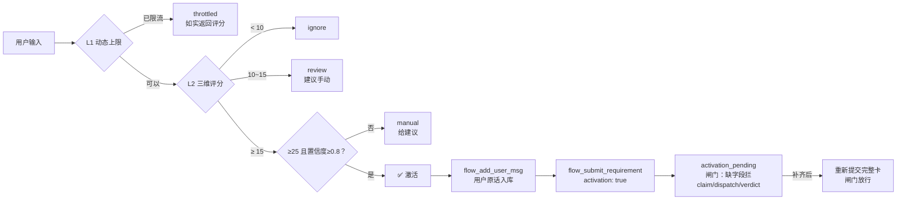

# Carlos Flow — 统一分发版（Cindy / OpenCode / Cursor / Cline / VS Code / Claude Desktop）

> **面向 AI 编码 Agent 的机械门禁**：留痕 → 派发 → 验证 → 裁定 → 审计 → 还原
> 把"相信 Agent"变成"验证 Agent"——机器级 scope 限制、真实命令执行、防篡改审计链。

**语言 / Languages:** [中文](README.zh.md) | [English](README.en.md)  
**版本 / Version:** 2.5.9 | **License:** MIT | **CI:** passing | **Node.js:** 22+ | **MCP:** 1.29+

---

## 🎯 一次安装，全平台可用

```bash
npm install -g carlos-flow
# 或
npx carlos-flow@latest init --target <平台>
```

| 平台 | 初始化命令 | 生成产物 |
|------|-----------|----------|
| **Cindy** | `carlos-flow init --target cindy` | `~/.cindy/ghosts/carlos-flow.json` |
| **OpenCode** | `carlos-flow init --target opencode` | `~/.config/opencode/plugin/opencode.json` + 项目 `.mcprc` |
| **Cursor / Windsurf** | `carlos-flow init --target cursor` | 项目 `.cursor/mcp.json` |
| **Cline** | `carlos-flow init --target cline` | 项目 `.cline/mcp.json` |
| **VS Code (GitHub Copilot)** | `carlos-flow init --target vscode` | 项目 `.vscode/mcp.json` |
| **Claude Desktop** | `carlos-flow init --target claude` | `~/Library/Application Support/Claude/claude_desktop_config.json` (macOS)<br>`%APPDATA%\Claude\claude_desktop_config.json` (Windows) |

> 💡 **环境变量**：`CARLOS_FLOW_HOME=~/.carlos-flow`（默认），`CARLOS_FLOW_MCP_ROOT`（源码安装时指向本仓库根目录）

---

## 🆕 v2.5.9 更新速览

### ✨ 统一分发包
- 单一 npm 包 `carlos-flow` 支持 **6 大主流 AI 编码平台**
- 核心 MCP Server (`src/index.js`) 零平台耦合，纯标准协议
- 平台差异仅在初始化模板，维护成本大幅降低

### 🔧 智能触发引擎（v2.5.5 引入，持续加固）
引擎会读取你的输入，自动判断现在是否该启动 Carlos 工作流——并且**告诉你为什么**。

| 层 | 组件 | 做什么 | 为什么需要它 |
|----|------|--------|-------------|
| **L1** | `DynamicTriggerManager` | 动态计算"本会话还允许触发几次" | 固定上限要么太吵、要么太严；会话越长、任务越复杂，上限自动放宽 |
| **L2** | `TriggerScorer` | 给每条消息打分：关键词 50 + 上下文 30 + 意图 20，加权后满分 **38** | 触发与否必须**可解释**——每次都告诉你命中了哪些词、得了多少分 |
| **L3** | `TriggerDecisionEngine` | 四档决策：`trigger` / `review` / `ignore` / `throttled` | 把"要不要触发"从模糊直觉变成明确规则 |

**两条触发路径，行为完全一致**：
| 路径 | 怎么触发 | 适用 |
|------|---------|------|
| **① MCP 工具** | 调 `flow_trigger_check`（传 `sessionId` + `message`），达标即**实际激活** | 任何 MCP 宿主 |
| **② 命令行客户端** | `node client/carlos.js flow_status '{"sessionId":"x","triggerMessage":"run dispatch workflow"}'` | 脚本 / 调试 |

---

## 🚀 30 秒快速开始

### 1. 安装
```bash
npm install -g carlos-flow
```
> ⚠️ **如果报 `ETARGET: No matching version found`** —— npm registry 元数据缓存未刷新。
> ```bash
> npm cache clean --force
> npm view carlos-flow versions  # 验证版本存在
> ```

### 2. 一键初始化（按你的平台选一个）
```bash
# Cindy 用户
carlos-flow init --target cindy

# OpenCode 用户
carlos-flow init --target opencode

# Cursor / Windsurf 用户
carlos-flow init --target cursor

# Cline 用户
carlos-flow init --target cline

# VS Code (Copilot) 用户
carlos-flow init --target vscode

# Claude Desktop 用户
carlos-flow init --target claude
```

### 3. 设置环境变量（可选，有默认值）
```bash
# 默认值已可用，如需自定义：
# CARLOS_FLOW_HOME=~/.carlos-flow          # 状态/审计目录（跨平台）
# CARLOS_FLOW_MCP_ROOT=/path/to/carlos-flow # 源码安装时指向仓库根目录
# BRIDGE_PORT=19099                         # Cindy Bridge 端口
```

### 4. 重启并验证
```bash
# CLI 验证
node client/carlos.js flow_status '{"sessionId":"probe"}'
# 期望输出里 has_card: false 即表示服务正常
```

---

## 🌟 核心能力

### 🔒 机械门禁（非建议性）
| 能力 | 实现方式 | 对比：原生 MCP / 提示词 |
|------|---------|------------------------|
| **越界拦截** | 运行时 `git diff` 对比卡片 `scope` 白名单 | ❌ 无 / 靠自觉 |
| **真实验证** | `spawn` 执行 `verify.cmd`，捕获 stdout/stderr/exitCode；记 PASS 前**必须**有验证通过证据 | ❌ 无 / Agent 自述 |
| **防篡改审计** | SHA-256 链式哈希（`prevHash`→`hash`），改一条全链断裂 | ❌ 无 / 无 |
| **可控免检** | 显式 `confirmed=true`，**每次派发自动清零** | ❌ 无 / 一句话全关 |
| **诚实派发配额** | `dispatch_count` 只在派发时 +1，耗尽即拦截 | ❌ 无 / 无 |
| **独立复核** | 内置 `auditor` 角色，独立合同，裁定三档 `PASS/DIRECTION/LOCAL` | ❌ 无 / 可选 |
| **快照 + 还原** | 派发前自动快照 → `flow_revert_plan` 生成原子还原计划 | ❌ 无 / 手动 `git revert` |
| **守护进程** | Bridge 首次调用自动拉起、健康检查、Token 认证、限流 | ❌ 手动 / 手动 |

### 🆕 智能触发引擎 — `src/trigger.js`
**动态决策 → 判断 → 激活** 完整闭环：



**关键特性**：
- 🎚️ **动态上限**：`5 + 会话时长(小时)×0.5 + 复杂度×2 − 窗口内已触发×0.3`，封顶 15
- 🛡️ **不打扰**：同会话最短间隔 5 分钟；触发越多上限**越低**（惩罚项）
- 📊 **评分透明**：返回完整 `breakdown`（命中关键词 / 上下文词 / 意图类型）
- ⚖️ **限流也如实**：被限流时照样返回真实评分与置信度
- 🧠 **反馈学习**：负反馈占多数时自动抬高触发阈值，更保守
- 🇨🇳 **中文开箱即用**：内置中文流程词；普通开发需求**不会误触发**

---

## 📦 包结构

```
carlos-flow/
├── client/carlos.js           # CLI 入口（含 init --target）
├── src/index.js               # 核心 MCP Server（stdio，标准协议）
├── src/trigger.js             # 智能触发引擎
├── bridge/mcp-bridge.js       # Cindy 专用：后台常驻 + Token 认证
├── plugins/carlos-flow-trigger.js  # OpenCode 专用：chat.message 钩子
├── ghost.json                 # Cindy 清单（__ROOT__ 占位符）
├── opencode.json              # OpenCode 配置（已渲染）
├── opencode.json.template     # OpenCode 模板
├── .mcprc.template            # OpenCode MCP 配置模板
├── trigger-config.usable.json # 触发器默认配置
├── templates/
│   ├── cursor/mcp.json        # Cursor / Windsurf
│   ├── cline/mcp.json         # Cline
│   ├── vscode/mcp.json        # VS Code (Copilot)
│   └── claude/claude_desktop_config.json  # Claude Desktop
└── test/                      # 全套测试（255/0 通过）
```

---

## 📚 详细文档

- [`TRIGGER_GUIDE.md`](TRIGGER_GUIDE.md) — 智能触发引擎完整使用指南
- [`CHANGELOG.md`](CHANGELOG.md) — 版本历史
- [QA 验收报告](docs/QA_REPORT_v2.5.5.md) — 第三方只读验收（13/13 变异体全抓住）

---

## 🛠️ 开发与测试

```bash
# 克隆源码
git clone https://github.com/skyer-now/carlos-flow.git
cd carlos-flow

# 安装依赖
npm install

# 跑全套测试（255 个用例）
npm run test:all

# 单独跑
npm run test:e2e      # 端到端 61 项
npm run test:p0       # P0 门禁 22 项
npm run test:trigger  # 触发引擎 29 项
npm run test:concurrency  # 并发 3 项
npm run test:acceptance   # 验收 13 项

# 变异测试（注入缺陷确认测试能抓住）
npm run test:mutation

# 本地打包
npm pack
```

---

## 🤝 贡献

欢迎 PR！请先跑 `npm run test:all` 确保 255/0 全通过。

---

## 📄 License

MIT © Carlos Flow Contributors