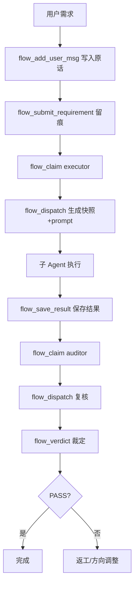

# Carlos 工作流 - Cindy 适配版

> 机械门禁 MCP：留痕 → 派发 → 裁定 → 审计 → 快照还原
> 自动管理 Bridge 后台常驻，首次调用 ~3-5s，后续复用 ~1s

## ✨ 特性

- **零配置启动**：首次调用自动拉起 Bridge，无需手动运行后台进程
- **Cindy 原生集成**：通过 `ghost.json` 声明，插件设置页可视化配置环境变量
- **密钥库保护**：Bridge Token 等敏感信息存入 Cindy 加密保险库，代码不含明文
- **全平台支持**：Windows / macOS / Linux 均可运行（需 Node.js 22+）
- **完整门禁流程**：12 个工具覆盖 T0/T1/T2 三档路由、四段合同、独立复核、审计链

## 📦 安装

### 方式一：Cindy 插件市场（推荐）

1. 打开 Cindy → 设置 → 插件 → 浏览市场
2. 搜索 `carlos-flow` 点击安装
3. 在插件设置页填写 `CARLOS_FLOW_MCP_ROOT` 和 `CARLOS_FLOW_HOME`
4. 重启 Cindy，输入 `/门禁` 或在对话中直接说“走门禁”

### 方式二：本地源码安装

```bash
# 1. 克隆仓库
git clone https://github.com/skyer-now/carlos-flow-cindy.git
cd carlos-flow-cindy

# 2. 安装依赖
npm install

# 3. 配置环境变量（复制模板并修改）
cp .env.example .env
# 编辑 .env 填入你的实际路径

# 4. 验证安装
npm test          # 冒烟测试（隔离临时目录）
npm run test:e2e  # 端到端测试（需配置好环境变量）
```

## ⚙️ 环境变量

| 变量 | 必填 | 说明 | 示例 |
|------|------|------|------|
| `CARLOS_FLOW_MCP_ROOT` | ✅ | MCP 源码根目录（含 `src/`、`bridge/`、`client/`） | `D:/cindy/carlos-flow-mcp` |
| `CARLOS_FLOW_HOME` | ✅ | 状态/审计/快照根目录 | `~/carlos-flow` |
| `BRIDGE_PORT` | ❌ | Bridge 监听端口（默认 19099） | `19099` |
| `REA_MCP_ROOT` | ❌ | rea MCP 源码根目录 | `D:/dev-env/rea` |
| `GHIDRA_HOME` | ❌ | Ghidra 安装目录 | `D:/dev-env/ghidra/ghidra_12.1.4_PUBLIC` |
| `JAVA_HOME` | ❌ | JDK 21 安装目录 | `D:/dev-env/jdk-21.0.12.1+1` |
| `NODE_PATH` | ❌ | Node.js 可执行文件路径（默认 `node`） | `node` |

> **提示**：Cindy 插件设置页修改环境变量后需**完全退出 Cindy 重启**生效。

## 🛠️ 可用工具（12 个）

| 工具 | 作用 |
|------|------|
| `flow_protocol` | 读取完整协议文档 |
| `flow_add_user_msg` | 写入用户原话（锚点数据源） |
| `flow_submit_requirement` | 提交任务卡（留痕 + 校验） |
| `flow_claim` | 领取派发名额（executor/auditor） |
| `flow_dispatch` | 生成派发 prompt + 文件快照 |
| `flow_verdict` | 记录裁定（PASS/DIRECTION/LOCAL） |
| `flow_status` | 查询门禁状态 |
| `flow_audit` | 读取审计流水 |
| `flow_diff_hunks` | git diff hunk 分析 |
| `flow_bypass` | 免检开关 |
| `flow_save_result` | 保存子 Agent 结果 |
| `flow_revert_plan` | 生成还原计划 |

## 🔄 工作流示例



## 🧪 测试

```bash
# 冒烟测试（完全隔离，不污染真实数据）
npm test

# 端到端测试（需配置好 CARLOS_FLOW_MCP_ROOT 等环境变量）
npm run test:e2e

# rea 真实 Ghidra 分析测试（需配置 GHIDRA_HOME/JAVA_HOME）
npm run test:rea
```

## 📁 目录结构

```
carlos-flow-cindy/
├── src/                    # MCP Server 核心（stdio 传输）
│   ├── index.js            # 入口：注册 12 个工具
│   ├── protocol.js         # 协议定义（路由表/合同/错误层/状态 schema）
│   ├── card.js             # 任务卡解析/修复/校验
│   ├── state.js            # 状态持久化/审计链/用户消息源
│   └── dispatch.js         # 四段合同/文件快照/结果保存
├── bridge/                 # TCP Bridge（安全桥接层）
│   ├── mcp-bridge.js       # 监听 127.0.0.1:19099，Token 认证、限流、超时控制
│   └── health.js           # /health 端点（就绪探测）
├── client/                 # CLI 客户端
│   ├── carlos.js           # 自动管理 Bridge 生命周期
│   └── rea.js              # rea 自包含客户端
├── test/                   # 测试套件
│   ├── smoke.js            # 冒烟测试（临时目录隔离）
│   ├── e2e-carlos.mjs      # 16 项端到端用例
│   └── e2e-rea.mjs         # 8 项 rea Ghidra 真实分析
├── ghost.json              # Cindy 插件清单
├── settings.html/js        # 插件设置页
├── .env.example            # 环境变量模板
├── package.json
└── README.md
```

## 🔒 安全设计

- **Bridge 仅监听 127.0.0.1**，拒绝外部连接
- **Token 认证**：每请求携带 `CARLOS_BRIDGE_TOKEN`，错误即拒绝
- **限流**：单连接 10 req/s，防止误刷
- **请求体上限**：1 MB，防止内存耗尽
- **审计链 SHA-256**：每条记录含 `prevHash`/`hash`，防篡改可验证

## 📄 许可证

MIT License - 详见 [LICENSE](LICENSE)

## 🤝 贡献

欢迎 PR！请先跑通 `npm test` 和 `npm run test:e2e`。

---

**从 OpenCode 版迁移？** 请看 [carlos-flow-opencode](https://github.com/skyer-now/carlos-flow-opencode) —— 纯 stdio 传输，无 Bridge，配置走 `.mcprc`/`opencode.json`。