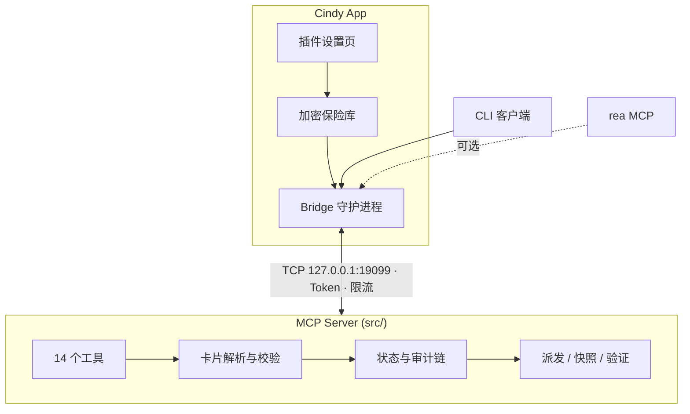

# Carlos Flow — Cindy 适配版

> **面向 AI 编码 Agent 的机械门禁**：留痕 → 派发 → 验证 → 裁定 → 审计 → 还原
> 把"相信 Agent"变成"验证 Agent"——机器级 scope 限制、真实命令执行、防篡改审计链。

[](README.en.md)
[](README.zh.md)
[](https://www.npmjs.com/package/carlos-flow-cindy)
[](https://www.npmjs.com/package/carlos-flow-cindy)
[](LICENSE)
[](https://github.com/skyer-now/carlos-flow-cindy/actions/workflows/ci.yml)
[](https://nodejs.org/)
[](https://modelcontextprotocol.io)

---

## 🎯 为什么选择 Carlos Flow？

绝大多数 AI 编码流程是**建议性的**。提示词写"只改这些文件"——Agent 客气地点头，然后把半个仓库重写了。提示词写"跑一下测试"——Agent 汇报"测试通过"，其实根本没跑。

Carlos Flow 是**机械性的**。约束写在代码里，不写在散文里。

### 消除的痛点

| 痛点 | 今天的典型状态 | Carlos Flow 的答案 |
|------|----------------|-------------------|
| **越界改动** | "只改 `src/auth.py`"——是建议，不是规则 | `enforceScope()` 用真实 `git diff` 对比卡片白名单，越界文件**直接阻断派发** |
| **验证表演** | Agent 声称"测试通过"，无人能证明 | `runVerifyCommand()` 真实 spawn `verify.cmd`，捕获 `stdout`/`stderr`/`exitCode` |
| **可洗白的审计日志** | 普通文件里的日志——可删可改 | SHA-256 **链式**审计日志（`prevHash`→`hash`），改一条全链断裂 |
| **失控的免检模式** | 一句话（"这很急，跳过门禁"）关闭所有防护 | 免检需卡片显式 `confirmed=true`，且**每次派发自动清零** |
| **无限派发额度** | 领卡即重置计数——可无限重试 | `dispatch_count` **只在派发时** +1；配额耗尽同时拦截 claim 和 dispatch |
| **忘记拉起守护进程** | "你启动服务了吗？" / 端口已被占用 | Bridge 首次调用自动拉起、健康检查、Token 认证、限流 |
| **自证式复核** | 同一个 Agent 既实现又审批 | 内置 `auditor` 角色，独立合同；裁定严格三档 `PASS`/`DIRECTION`/`LOCAL` |
| **改坏了无法回退** | 只能手动 `git revert` | 派发前自动快照 → `flow_revert_plan` 生成原子还原计划 |

### 差异对比

| 能力 | **Carlos Flow** | 原生 MCP Server | 提示词 / 手写脚本 |
|------|-----------------|-----------------|------------------|
| **越界拦截** | ✅ 运行时 `git diff` 级 | ❌ 无 | ❌ 靠自觉 |
| **真实验证** | ✅ spawn 执行并捕获输出 | ❌ 无 | ❌ Agent 自述 |
| **防篡改审计** | ✅ SHA-256 链式哈希 | ❌ 无 | ❌ 无 |
| **可控免检** | ✅ 显式开启 + 自动清零 | ❌ 无 | ❌ 一句话全关 |
| **诚实派发配额** | ✅ 只计派发 | ❌ 无 | ❌ 无 |
| **独立复核** | ✅ 内置 `auditor` 角色 | ❌ 无 | ❌ 可选 |
| **快照 + 还原** | ✅ 自动、原子计划 | ❌ 无 | ❌ 手动 `git revert` |
| **守护进程生命周期** | ✅ 全自动（Cindy 版） | ❌ 手动 | ❌ 手动 |

---

## 🚀 30 秒快速开始

### 方式一：Cindy 插件市场（推荐）

1. Cindy → 设置 → 插件 → 浏览市场
2. 搜索 `carlos-flow` 点击安装
3. 在插件设置页填写环境变量
4. **完全退出 Cindy 重启**，然后说"走门禁"

### 方式二：从源码安装

```bash
git clone https://github.com/skyer-now/carlos-flow-cindy.git
cd carlos-flow-cindy
npm install
cp .env.example .env      # 编辑：CARLOS_FLOW_MCP_ROOT、CARLOS_FLOW_HOME
npm test                  # 冒烟测试（完全隔离）
npm run test:e2e          # 16 项端到端用例
```

---

## 🌟 核心能力

### 1️⃣ 真实验证 — `flow_run_verify`

```typescript
const result = await runVerifyCommand(card.verify.cmd, cwd);
// { ok: boolean, exitCode: number, stdout: string, stderr: string, durationMs: number }
```

真实 spawn 子进程，捕获完整输出，60 秒熔断。不再是"相信我，跑过了"。

### 2️⃣ 越界拦截 — `flow_check_scope`

```typescript
const result = enforceScope(scopeWhitelist, changedFiles);
// { ok: boolean, violations: string[] }
```

机器级对比工作区变更与卡片白名单，文件级精度，未改动文件零误报。

### 3️⃣ 防篡改审计链 — `verifyAuditChain`

```typescript
const result = verifyAuditChain({ sinceIndex: 0 });
// { ok: boolean, brokenAt?: number, detail?: string }
```

每条记录携带 `prevHash`、`hash`、`seq`。改动一个字节，下游全部失效——是数学保证，不是管理保证。

### 4️⃣ 可控免检 — `flow_bypass` + `isBypassed()`

- 必须显式开启（`bypass=true` **且** `confirmed=true`）
- 每次派发自动清零——不可能"忘记关掉"
- 每次开关都写入审计链

### 5️⃣ 诚实派发配额 — `dispatch_count`

- **只在** `flow_dispatch` 递增；`flow_claim` / `flow_verdict` 永不计数
- 配额耗尽同时阻断 claim 与 dispatch
- 无无限重试路径

### 6️⃣ 快照与还原 — `flow_dispatch` → `flow_revert_plan`

- `scope` 内文件在每次派发前自动快照
- `flow_revert_plan` 输出原子化、有序（由新到旧）的还原计划
- 支持部分回滚

### 7️⃣ 独立复核 — `auditor` 角色

- 独立的四段合同，强制自行取证
- Auditor 必须自己跑 `git status --porcelain` / `git diff`
- 裁定枚举严格：`PASS` / `DIRECTION` / `LOCAL`

---

## 📖 典型场景

### 场景 1 — 新功能开发


### 场景 2 — Bug 修复
- 卡片 `quote` 锚定用户原话——Agent 不能悄悄改写需求
- `scope` 收窄到单文件
- `verify.cmd` 跑的是回归测试，不是手写总结

### 场景 3 — 大规模重构
- 多文件 `scope` 统一白名单管理
- 快照兜底半途而废的重构
- 还原计划是最后的安全网

### 场景 4 — 安全审计 / 敏感路径
- T2 风险档强制要求 `confirmed=true`
- 敏感路径（`config/`、`secrets/`、`infra/` 等）自动标记并拦截
- 审计链提供防篡改证据链

### 场景 5 — CI / PR 门禁
- 同一套流程，由 CI 驱动
- 裁定结果可阻断合并
- 审计日志归档以备合规

---

## 🏗️ 架构



### Cindy 版为什么要用 Bridge？

| 维度 | Cindy 版（本仓库） | OpenCode 版 |
|------|------------------|-------------|
| 传输协议 | TCP Bridge `127.0.0.1:19099` | 纯 stdio |
| 守护进程 | **全自动**——首次调用拉起、健康检查 | 由 OpenCode 托管 |
| 配置方式 | 插件设置页 + 环境变量 | `.mcprc` / `opencode.json` |
| 密钥存储 | **Cindy 加密保险库**，代码零明文 | 明文配置（用户自行管理） |
| rea 集成 | 内置 `client/rea.js` | 需另注册 MCP server |
| 适用场景 | Cindy App 用户 | OpenCode 2.2.2+ 用户 |

---

## 🛠️ 14 个工具

### 📝 卡片与留痕
| 工具 | 作用 | 关键参数 |
|------|------|----------|
| `flow_protocol` | 读取完整协议（档位 T0/T1/T2、合同、错误分层、状态 schema） | — |
| `flow_add_user_msg` | 写入用户原话（锚点数据源） | `sessionId`, `text` |
| `flow_submit_requirement` | 提交任务卡（校验 + 留痕） | `goal`, `quote`, `scope`, `acceptance`, `confirmed` |

### 🚀 派发与执行
| 工具 | 作用 | 关键参数 |
|------|------|----------|
| `flow_claim` | 领取派发名额，返回四段合同 | `sessionId`, `role`（`executor`\|`auditor`） |
| `flow_dispatch` | 生成合同 prompt + 自动文件快照 | `sessionId`, `role`, `message`, `run?` |
| `flow_run_verify` | **真实执行 `verify.cmd`** | `sessionId` |
| `flow_check_scope` | **机器级 scope 越界拦截** | `sessionId`, `paths[]` |

### ⚖️ 裁定与状态
| 工具 | 作用 | 关键参数 |
|------|------|----------|
| `flow_verdict` | 记录裁定（`PASS`/`DIRECTION`/`LOCAL`） | `sessionId`, `verdict`, `notes` |
| `flow_status` | 查询完整门禁状态 | `sessionId` |

### 🔍 审计与取证
| 工具 | 作用 | 关键参数 |
|------|------|----------|
| `flow_audit` | 读取审计流水（按类型/时间/会话筛选） | `sessionId`, `type?`, `since?` |
| `flow_diff_hunks` | git diff hunk 级分析 | `sessionId`, `scope?` |
| `flow_revert_plan` | 生成原子还原计划 | `sessionId` |

### 🛡️ 免检与还原
| 工具 | 作用 | 关键参数 |
|------|------|----------|
| `flow_bypass` | 免检开关（需 `confirmed`） | `sessionId`, `bypass`, `confirmed` |

> 完整工具参考：运行时调用 `flow_protocol`，它是权威的机器可读规范。

---

## ⚙️ 环境变量

| 变量 | 必填 | 说明 | 示例 |
|------|------|------|------|
| `CARLOS_FLOW_MCP_ROOT` | ✅ | MCP 源码根目录（含 `src/` `bridge/` `client/`） | `D:/cindy/carlos-flow-mcp` |
| `CARLOS_FLOW_HOME` | ✅ | 状态 / 审计 / 快照根目录 | `~/carlos-flow` |
| `BRIDGE_PORT` | ❌ | Bridge 监听端口（默认 `19099`） | `19099` |
| `REA_MCP_ROOT` | ❌ | rea MCP 源码根目录 | `D:/dev-env/rea` |
| `GHIDRA_HOME` | ❌ | Ghidra 安装目录 | `D:/dev-env/ghidra/ghidra_12.1.4_PUBLIC` |
| `JAVA_HOME` | ❌ | JDK 21 安装目录 | `D:/dev-env/jdk-21.0.12.1+1` |
| `NODE_PATH` | ❌ | Node.js 可执行文件路径（默认 `node`） | `node` |

> **提示**：插件设置页修改后需**完全退出 Cindy 重启**生效。

---

## 🧪 测试

```bash
npm test          # 冒烟测试——隔离临时目录，< 10s
npm run test:e2e  # 16 项端到端用例
npm run test:rea  # 8 项 rea Ghidra 真实分析
```

CI 在 **ubuntu-latest** 与 **windows-latest** 上对每次 push / pull request 运行。

---

## 📋 变更日志

完整历史 → [CHANGELOG.md](CHANGELOG.md)

### v2.5.2 — 2026-11-04 · Phase 1 P0 全修复

| 类型 | 变更 |
|------|------|
| ✨ 新增工具 | `flow_run_verify`、`flow_check_scope` |
| ✨ 核心 | `runVerifyCommand()` 真实执行 `verify.cmd` |
| ✨ 核心 | `enforceScope()` 机器级 scope 越界拦截 |
| ✨ 核心 | `verifyAuditChain()` SHA-256 审计链校验 |
| ✨ 核心 | `isBypassed()` 免检模式真实判定 |
| 🐛 修复 | role 白名单（仅 `executor`/`auditor`，拼错即报错） |
| 🐛 修复 | `dispatch_count` 仅在 dispatch 时递增 |
| 🐛 修复 | 免检状态在新派发时自动清零 |
| 🐛 修复 | 过期卡 / 配额 / 裁定枚举 / 参数校验 |

> ⚠️ **v2.5.1 存在 18 项 P0 缺陷**，请升级到 **v2.5.2 或更高版本**。

---

## ❓ 常见问题

| 现象 | 解决 |
|------|------|
| Bridge 端口冲突（`EADDRINUSE`） | 改 `BRIDGE_PORT`，或 `lsof -ti:19099 \| xargs kill` |
| 插件设置页改完不生效 | **完全退出 Cindy 并重启**（不是最小化到托盘） |
| 审计链校验失败 | 检查 `CARLOS_FLOW_HOME` 权限，或删除 `audit/` 重建 |
| 验证命令超时 | `verify.cmd` 超过 60s 会被熔断，建议拆成快速命令 |
| scope 越界误报 | `scope` 用相对路径，`git diff --name-only` 需一致 |

---

## 📄 许可证

MIT —— 见 [LICENSE](LICENSE)

---

## 🤝 贡献

欢迎 PR！请先跑通 `npm test` 和 `npm run test:e2e`。详见 [CONTRIBUTING.md](CONTRIBUTING.md)。

---

**用 OpenCode？** → [carlos-flow-opencode](https://github.com/skyer-now/carlos-flow-opencode) —— 纯 stdio，无 Bridge，配置走 `.mcprc` / `opencode.json`。
