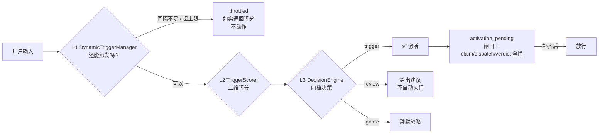
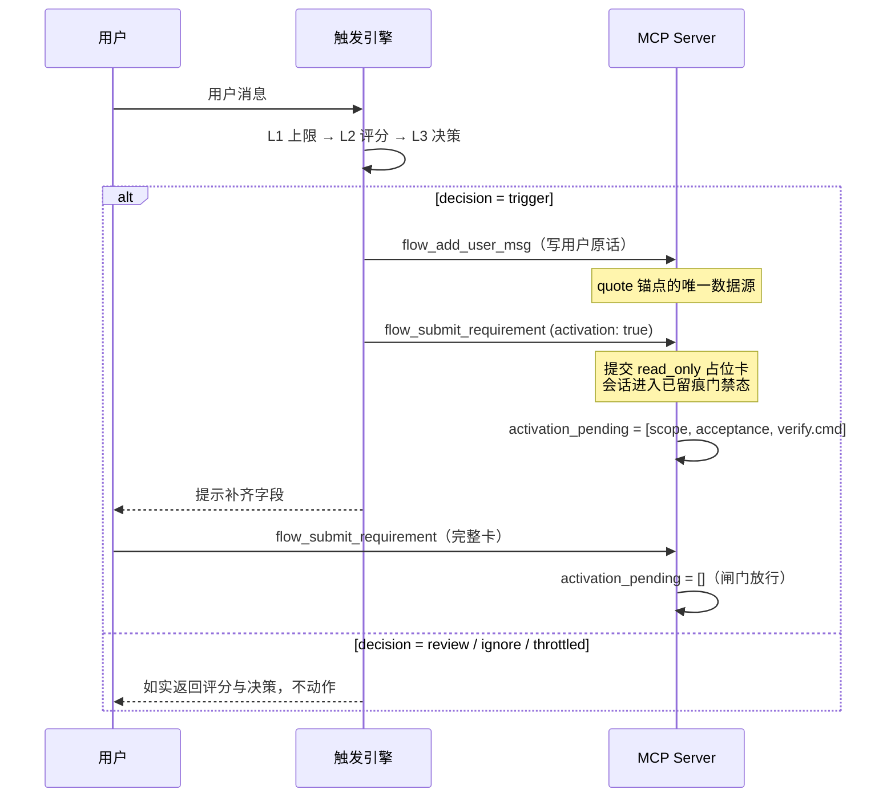

# Carlos Flow 智能触发引擎使用指南

> **版本**: v2.9.0
> **适用**：`carlos-flow` 单包架构（2.6.0+）
> **代码位置**：`src/trigger.js`（零外部依赖的纯 JavaScript 实现）

---

## 📋 概述

Carlos Flow 智能触发引擎是一个三层智能系统，能够自动感知用户意图并在合适的时机触发工作流。它具备以下特点：

### 核心特性

1. **动态上限控制** - 基于会话时长、任务复杂度和触发历史动态调整触发上限
2. **评分系统** - 对每个用户输入评分：关键词 50 + 上下文 30 + 意图 20，加权后满分 **38**
3. **决策引擎** - 基于评分和动态上限决定是否触发工作流（四档：`trigger` / `review` / `ignore` / `throttled`）
4. **激活机制** - 把判定转成**可执行的 MCP 动作序列**：留痕 → 占位卡 → 闸门 → 放行
5. **会话隔离** - 触发历史与限流状态按 session 分文件存放，多会话互不干扰
6. **用户反馈学习** - 记录用户接受/拒绝，持续优化触发
7. **零外部依赖** - 纯 JavaScript 实现，无需 npm 包
8. **可解释性** - 每次决策都返回完整 `breakdown`（命中词 / 语境词 / 意图类型 + 各维度得分）

### 三层架构总览



### 系统架构

```
┌─────────────────────────────────────────────────────────────┐
│                      用户输入                                  │
└─────────────────────────────────────────────────────────────┘
                            ↓
┌─────────────────────────────────────────────────────────────┐
│          L1: DynamicTriggerManager (动态上限)                 │
│          - 计算当前触发上限                                     │
│          - 管理历史触发记录                                     │
│          - 确保最少触发间隔                                     │
└─────────────────────────────────────────────────────────────┘
                            ↓
┌─────────────────────────────────────────────────────────────┐
│        L2: TriggerScorer (评分系统)                           │
│        - 关键词匹配 (0-50 分)                                  │
│        - 上下文相关性 (0-30 分)                                │
│        - 用户意图识别 (0-20 分)                                │
└─────────────────────────────────────────────────────────────┘
                            ↓
┌─────────────────────────────────────────────────────────────┐
│    L3: TriggerDecisionEngine (决策引擎)                       │
│    - 综合评分计算                                             │
│    - 触发决策 (trigger/ignore/review)                         │
│    - 用户反馈记录                                             │
└─────────────────────────────────────────────────────────────┘
```

## ⚙️ 配置说明

### 配置文件位置

| 文件 | 位置 | 说明 |
|------|------|------|
| `trigger-config.json` | `$CARLOS_FLOW_HOME/trigger-config.json` | 自定义阈值与权重；不存在则用默认值 |
| `trigger-state.json` | `$CARLOS_FLOW_HOME/trigger-state.json` | 触发历史与学习数据 |

`CARLOS_FLOW_HOME` 未设置时，默认落在 `~/.carlos-flow`（与 `src/state.js` 的 `FLOW_HOME` 同一约定）。
配置与状态**不会**写入仓库目录，也**不会**污染 npm 包。

### 默认配置参数

```json
{
  "baseTriggerLimit": 5,
  "maxTriggerLimit": 15,
  "sessionLengthCoeff": 0.5,
  "complexityCoeff": 2,
  "historyCoeff": 0.3,
  "decayRate": 0.98,
  
  "keywordWeights": {
    "work": 3,
    "flow": 3,
    "carlos": 4,
    "dispatch": 3,
    "trigger": 2,
    "start": 1,
    "run": 1,
    "execute": 2,
    "工作流": 3,
    "门禁": 4,
    "任务卡": 3,
    "派发": 3,
    "子代理": 3,
    "流程": 2,
    "触发": 2,
    "执行": 2,
    "调度": 2,
    "审计": 2,
    "复核": 2,
    "留痕": 2,
    "裁定": 2
  },
  
  "contextRelevanceWeight": 0.3,
  "userIntentWeight": 0.2,
  
  "triggerThreshold": 15,
  "autoTriggerThreshold": 25,
  "lowConfidenceThreshold": 10,
  
  "feedbackLearningRate": 0.1,
  "positiveFeedbackWeight": 1.5,
  "negativeFeedbackWeight": 0.7,
  
  "triggerWindowMinutes": 60,
  "minTriggerIntervalSeconds": 300
}
```

### 参数说明

#### 动态上限参数
- `baseTriggerLimit`: 基础触发上限（0 会话时）
- `maxTriggerLimit`: 最大触发上限（防止过度触发）
- `sessionLengthCoeff`: 会话时长系数（每小时增加量）
- `complexityCoeff`: 任务复杂度系数（基于参数）
- `historyCoeff`: 历史触发频率系数
- `decayRate`: 历史触发衰减率（随时间减弱）

> ⚠️ **公式里 `historyCoeff` 是减项（惩罚），不是加项。**
> 早期实现误写成加法 —— 触发越多上限反而越高，封顶逻辑自我抵消，
> 于是「窗口内次数达上限」分支永远不可达。已修正并有回归用例守护。

#### 评分参数
- `keywordWeights`: 关键词权重配置
- `contextRelevanceWeight`: 上下文相关性权重
- `userIntentWeight`: 用户意图识别权重

#### 决策阈值
- `triggerThreshold`: 最低触发阈值（15 分以上触发）
- `autoTriggerThreshold`: 自动触发阈值（25 分以上自动）
- `lowConfidenceThreshold`: 低置信度阈值（低于此忽略）

---

## 🧮 评分公式（完整推导）

### 动态上限

```
rawLimit = baseTriggerLimit
         + (sessionAgeHours × sessionLengthCoeff)
         + (sessionComplexity × complexityCoeff)
         - (triggersInWindow × historyCoeff)

dynamicLimit = clamp(floor(rawLimit), 1, maxTriggerLimit)
```

**示例**（会话 2 小时、复杂度 1.5、窗口内已触发 3 次）：

```
rawLimit = 5 + (2 × 0.5) + (1.5 × 2) - (3 × 0.3)
         = 5 + 1 + 3 - 0.9
         = 8.1  →  floor = 8
dynamicLimit = min(8, 15) = 8
```

### 三维评分

```
keywordScore   = min(Σ(命中词权重) × 5, 50)     // 关键词维度，满分 50
contextScore   = min(Σ(命中语境词) × 3 × complexity, 30)  // 上下文维度，满分 30
intentScore    = min(Σ(命中意图类型) × 20, 20)   // 意图维度，满分 20

totalScore = round(
    keywordScore × (1 - contextRelevanceWeight - userIntentWeight)
  + contextScore × contextRelevanceWeight
  + intentScore  × userIntentWeight
)
```

默认权重（`contextRelevanceWeight=0.3`, `userIntentWeight=0.2`）下：

```
totalScore = keywordScore × 0.5 + contextScore × 0.3 + intentScore × 0.2
```

**理论满分**：`(50 × 0.5) + (30 × 0.3) + (20 × 0.2) = 25 + 9 + 4 = 38`

> 这就是 README 里说的「加权后满分 **38**」—— 它不是拍脑袋的常数，而是三个维度的加权上限。

### 置信度

| 命中总数（关键词 + 语境 + 意图类型） | 置信度 |
|-----------------------------------|-------|
| 0 | 0.3 |
| 1 ~ 2 | 0.6 |
| ≥ 3 | 0.9 |

### 决策

```
effectiveThreshold = max(1, threshold + feedbackAdjustment)

threshold = (score ≥ autoTriggerThreshold && confidence ≥ 0.8)
          ? autoTriggerThreshold   // 25
          : triggerThreshold        // 15

decision:
  限流（间隔不足 / 窗口内超上限）    → throttled
  score ≥ effectiveThreshold          → trigger
  score <  lowConfidenceThreshold(10) → ignore
  否则                                → review
```

---

## 🔀 配置合并语义（重要）

配置加载**不是**简单的 `{ ...DEFAULT, ...loaded }`。字段分三类处理：

| 字段类型 | 语义 | 例子 |
|---------|------|------|
| **对象** | **合并**（用户覆盖同名默认项，其余默认项保留） | `keywordWeights` |
| **数组** | **追加去重**（扩展，不是替换） | `readOnlyIntentWords` / `mutatingActionWords` |
| **标量** | 覆盖 | 阈值、权重、系数 |

### 为什么必须这样

早期实现是**浅合并**。后果：

```json
{ "keywordWeights": { "评审": 5 } }
```

用户只想加一个词，结果**整个默认词表被丢掉** —— 包括内置的中文流程词。
于是「我只是加一个自定义词」反而让所有默认词失效，中文场景重新变回 0 分。

### 类型不合法时的兜底

若用户写 `"keywordWeights": null` 或 `"keywordWeights": [1,2]`：

- 浅合并会把非法值带进 `config.keywordWeights`
- `buildKeywordIndex()` 的 `Object.entries(null)` 抛 TypeError
- 触发引擎在该进程内**每次调用都失败**（客户端 catch 掉 → **静默失去自动触发**）

现在：类型不对就**丢弃用户值 + 回退默认表 + 打印警告**，
并且在合并后再兜一次底。

```json
{ "readOnlyIntentWords": "not-array" }
```

→ 警告 + 回退默认词表，引擎正常工作。

### 非法 JSON

配置文件损坏时 → 警告 + 全量回退默认配置，**引擎不崩**。

---

## 🔁 激活闸门时序（防假闭环）

自动触发**不等于**直接放行。完整时序：



### 闸门期间被拒绝的操作

| 操作 | 拒绝原因 |
|------|---------|
| `flow_claim` | 激活占位卡尚未补齐（待补：scope、acceptance、verify.cmd） |
| `flow_dispatch` | 同上 |
| `flow_verdict` | 同上 —— **防未执行就记 PASS 的假闭环** |

### 关键安全约束

1. **会话已有任务卡时自动激活会跳过开卡** —— 不覆盖用户已有任务
2. **自动激活只负责「留痕 + 进入门禁」** —— 绝不代替 Agent 决定改哪些文件
3. **普通卡不上闸门** —— 未标 `activation` 且该会话从未被激活过的普通卡片，
   `activation_pending` 保持为空（`read_only` 档只需 `goal` + `quote`，
   否则会误伤 T1 只读调研场景）
4. **待补项由服务端从卡片内容派生** —— 不是硬编码三项，而是根据当前卡片实际缺什么计算

---

## 🚀 使用方式

### 1. 在 `carlos.js` 中使用

智能触发引擎已集成到 `carlos.js` 客户端中。调用时自动执行触发检查：

```bash
node carlos.js flow_dispatch {"sessionId":"default"}
```

在调用 MCP 工具之前，引擎会检查用户意图并可能自动触发工作流。

### 2. 独立使用触发引擎

在 Node.js 项目中直接使用：

```javascript
import TriggerEngine from './src/trigger.js';

// 创建引擎实例
const engine = TriggerEngine.create('session-123');

// 检查是否触发
const result = engine.shouldTrigger('运行 dispatch 工作流', {
  sessionId: 'session-123',
  complexity: 1.2
});

if (result.shouldTrigger) {
  console.log('✅ 触发工作流！');
  // 执行后续流程...
} else {
  console.log('❌ 暂不触发');
}

// 记录用户反馈
engine.recordFeedback('positive'); // 用户接受
engine.recordFeedback('negative'); // 用户拒绝
```

### 3. 通过 CLI 客户端集成

触发引擎已集成到 `client/carlos.js`：每次调用 MCP 工具前先做一次触发检查。
命中后**不只是打印日志**——它会执行[激活流程](#🔁-激活机制判断--动作)，真正把会话推进门禁态。

```bash
# triggerMessage 传入真实用户原话（也可用环境变量 CARLOS_TRIGGER_MESSAGE）
node client/carlos.js flow_status '{"sessionId":"my-task","triggerMessage":"run dispatch workflow"}'
```

stderr 输出：
```
[Carlos Trigger] 判定触发：评分 37 · 置信度 0.9
[Carlos Trigger] 已执行激活步骤：flow_add_user_msg（写入用户原话，作为任务卡 quote 锚点校验的数据源）
[Carlos Trigger] 已执行激活步骤：flow_submit_requirement（开卡：将会话置为已留痕状态，审计链记录 activation 事件）

【Carlos 触发引擎已激活工作流】
…
```

> ⚠️ **`triggerMessage` 必须显式传入，否则完全不启用自动触发。**
>
> - `triggerMessage` 是**客户端专用字段**，不会被透传给 MCP 工具（`complexity` 同样剥离）；
> - 默认词表**中英文都有**：英文 `work` / `flow` / `carlos` / `dispatch` / `trigger` / `start` / `run` / `execute`，
>   中文 `工作流` / `门禁` / `任务卡` / `派发` / `子代理` / `流程` / `触发` / `执行` / `调度` / `审计` / `复核` / `留痕` / `裁定`
>   （上下文表另有 `executor` / `auditor`；意图表另有 `auto` / `process` / `monitor` 等）。
>   词表只收**流程性**词汇，不收「实现 / 新增 / 接口」这类普通开发动词 ——
>   所以「走门禁流程」会触发，而「给接口加个参数校验」不会误触发。
> - 需要自定义时用 `CARLOS_FLOW_HOME/trigger-config.json`：里面的 `keywordWeights` 是
>   **追加/覆盖同名项**（默认词表保留），`readOnlyIntentWords` / `mutatingActionWords` 是**追加去重**；
> - 早先版本的兜底项是「工具名 + 参数 JSON」，会造成**自伤**（参数含触发词 → 自己开占位卡 →
>   同一次调用的 `flow_dispatch` 反被闸门拒绝）与**锚点污染**（写入的「用户原话」是命令行文本 →
>   Agent 用真实原话重提卡时 quote 锚点校验失败 → 补齐流程卡死）。现已改为**不传即不触发**。

> **当前定位**：触发引擎是**库级能力**（`src/trigger.js`），但它**已经**作为第 15 个 MCP 工具
> **`flow_trigger_check`** 暴露给宿主 Agent —— 调用它即可获得与命令行客户端完全一致的评分与激活行为：
> 达标时**实际完成激活**（写入用户原话 + 开占位卡 → 会话进入门禁态），未达标只如实返回评分。
>
> 三条触发路径（行为一致）：
> 1. **MCP 工具** —— 调 `flow_trigger_check`（任何 MCP 宿主均可）
> 2. **OpenCode 插件** —— `plugins/carlos-flow-trigger.js` 监听 `chat.message` 自动调用（opencode 版专有）
> 3. **命令行客户端** —— `node client/carlos.js ... --triggerMessage "..."`

## 📊 评分计算详解

### 总分计算公式

```
总分 = 关键词分 × 0.5 + 上下文分 × 0.3 + 意图分 × 0.2
```

### 各维度分数范围

| 维度 | 基础分数 | 权重 | 贡献上限 |
|------|----------|------|----------|
| 关键词匹配 | 0-50 | 0.5 | 25 |
| 上下文相关性 | 0-30 | 0.3 | 9 |
| 用户意图识别 | 0-20 | 0.2 | 4 |
| **总计** | - | - | **38** |

### 决策逻辑（与 `src/trigger.js` 实现逐行对应）

```javascript
// 1) 先算评分（即使随后被限流，评分与置信度也要如实返回）
const score = scorer.calculateImpulseScore(message, context, historyCount).score;

// 2) 动态上限 / 最短间隔检查
if (!canTrigger().can) {
  return { decision: 'throttled', score, confidence, breakdown };  // 限流
}

// 3) 阈值选择：高置信度时用自动阈值，否则用普通阈值
const threshold = (score >= autoTriggerThreshold && confidence >= 0.8)
  ? autoTriggerThreshold
  : triggerThreshold;

// 4) 叠加反馈学习偏移（负反馈多 → 更保守）
const effectiveThreshold = Math.max(1, threshold + feedbackAdjustment);

// 5) 判定
if (score >= effectiveThreshold)      decision = 'trigger';   // ✅ 达标，进入激活流程
else if (score < lowConfidenceThreshold) decision = 'ignore';  // ❌ 低于 10 分，忽略
else                                   decision = 'review';   // ⚠️ 临界，建议手动启动
```

| 决策 | 含义 | 是否动作 |
|------|------|---------|
| `trigger` | 评分达标 | **进入激活流程**（自动档：评分 ≥ 25 且置信度 ≥ 0.8） |
| `review` | 临界区间 | 只输出建议与补全指引，**不执行任何 MCP 动作** |
| `ignore` | 低于 `lowConfidenceThreshold` | 无动作 |
| `throttled` | 被动态上限或最短间隔拦下 | 无动作，但**如实返回真实评分与置信度** |

> ⚠️ 限流时依然返回真实的 `score` / `confidence` / `breakdown`，不会丢成 0，也不会假装“未评分”。

### 置信度口径

`confidence` 由**命中项数量**决定（`calculateConfidence()`）：

| 命中项数 | confidence | 含义 |
|---------|-----------|------|
| 0 | **0.3** | 没命中任何词/意图 —— 低置信度 |
| 1 ~ 2 | **0.6** | 中等置信度 |
| ≥ 3 | **0.9** | 高置信度（可走自动档） |

命中项 = 命中的关键词数 + 命中的上下文词数 + 意图类型是否非 `generic`。

> 📌 已知口径特性：关键词表与上下文表有重叠（`work` / `flow` / `dispatch` 同时出现在两张表里），
> 同一个词会被计入两次，因此 `confidence` 偏乐观。这是**已知并接受的现状**，
> 真正决定是否触发的是**加权总分**，不是 confidence。

---

## 🔁 激活机制（判断 → 动作）

决策本身只是判断。**激活机制**负责把判断变成**真实执行的门禁动作**。

### 三个阶段

| 阶段 | 组件 | 产物 |
|------|------|------|
| **判断** | `TriggerDecisionEngine.shouldTrigger()` | `decision` + `score` + `confidence` + `breakdown` |
| **翻译** | `TriggerDecisionEngine.buildActivationPlan()` | 可执行的 MCP 动作序列（每步带 `auto` 标记） |
| **激活** | `client/carlos.js` 逐步执行 | 会话进入“已留痕”门禁态 |

### 激活计划长什么样

```javascript
const result = engine.shouldTrigger('run dispatch workflow', { sessionId: 'my-task' });

result.activationPlan = {
  activated: true,
  decision: 'trigger',
  score: 38,
  confidence: 0.9,
  matchedKeywords: ['work', 'flow', 'dispatch', 'run'],
  goal: '执行 Carlos 工作流任务：run dispatch workflow（命中：work, flow, dispatch, run）',
  steps: [
    { tool: 'flow_add_user_msg',      auto: true  },  // 自动：留痕用户原话
    { tool: 'flow_submit_requirement', auto: true  },  // 自动：提交 read_only 占位卡
    { tool: 'flow_submit_requirement', auto: false },  // 引导：补齐字段后重新提交
      // needsFill 不是固定三项：待补字段由**服务端从当前卡片内容派生**
      // （scope / acceptance / verify.cmd 缺哪个就锁哪个，都齐了才解闸）。
      needsFill: '<由服务端派生：scope / acceptance / verify.cmd 中当前缺失的项>' },
  ],
  pendingFields: '<由服务端从卡片内容派生，非固定三项>',
  prompt: '【Carlos 触发引擎已激活工作流】…',
};
```

### 激活的四个实际动作

1. **留痕用户原话** — `flow_add_user_msg`
   把用户原话写进会话消息文件。它是任务卡 `quote` 锚点校验的**唯一数据源**，必须先于开卡。

2. **提交占位卡** — `flow_submit_requirement`（`activation: true`）
   以 `read_only` 档提交（只要求 `goal` + `quote`），**会话进入已留痕门禁态**，审计链记录激活事件。

3. **闸门生效** — `activation_pending`
   状态里记下待补齐字段 `scope` / `acceptance` / `verify.cmd`。
   在补齐之前，以下三个工具 **一律拒绝**：

   | 工具 | 拒绝原因 |
   |------|---------|
   | `flow_claim` | 不能拿一张没补齐的卡去领派发名额 |
   | `flow_dispatch` | 不能拿一张没补齐的卡去派发执行 |
   | `flow_verdict` | **防假闭环**——未经派发**且未验证通过**，不能直接记 PASS（`DIRECTION` / `LOCAL` 不受此限） |

   ```
   ERROR: 激活占位卡尚未补齐（待补：scope、acceptance、verify.cmd）。
   请先补齐后重新调用 flow_submit_requirement，再来领取派发名额。
   ```

4. **补齐后放行** — 重新提交完整卡
   Agent 补齐字段后重新调用 `flow_submit_requirement`（**不带** `activation`），
   `activation_pending` 被清空，门禁解除，可以正常 `flow_claim` / `flow_dispatch`。

### 安全约束

| 约束 | 行为 |
|------|------|
| 会话**已有任务卡** | 跳过自动开卡，**不覆盖用户已有任务** |
| 占位卡**不许记 PASS** | `flow_verdict` 在字段未补齐时拒绝，堵住「未执行、未验证、却直接完成」的假闭环 |
| 自动激活**不决定改哪些文件** | 只负责“留痕 + 进入门禁”，`scope` 必须由 Agent 确认 |
| 目标描述是**推断值** | `goal` 由关键词推导，**标记为占位**，需与用户确认后改写 |
| `manual` 档 | 只输出建议与补全指引，**不执行任何 MCP 动作** |

### 手动使用激活计划

```javascript
const plan = result.activationPlan;
for (const step of plan.steps) {
  if (!step.auto) continue;        // 只执行参数完整的步骤
  await callMCP('tools/call', { name: step.tool, arguments: step.args });
}
// 然后把 plan.prompt 交给 Agent，让它补齐字段
```

---

## 🔄 动态上限计算

### 公式

```
动态上限 = clamp(
  baseTriggerLimit +
  (会话时长小时数 × sessionLengthCoeff) +
  (任务复杂度 × complexityCoeff) -
  (窗口内触发次数 × historyCoeff),
  1, maxTriggerLimit
)
```

> **设计要点**：会话越长、任务越复杂 → 上限越高（允许更多触发）；
> 近期触发越频繁 → 上限越低（收敛打扰）。
> 历史项是**惩罚项**而非增益项 —— 若为增益，触发次数会把上限反向抬高，封顶逻辑将自我抵消而永不生效。

### 示例

- 新会话（0 小时），复杂度 1.0，无历史 → 上限 = 5 + 0 + 2 - 0 = **7**
- 2 小时会话，复杂度 1.2，窗口内 3 次触发 → 上限 = 5 + 1 + 2.4 - 0.9 = **7**
- 5 小时会话，复杂度 1.5，窗口内 0 次触发 → 上限 = 5 + 2.5 + 3 = **10**

### 上限判定

```
窗口内触发次数 = countTriggersInWindow()   // 原始计数
if (窗口内触发次数 >= 动态上限) → 拒绝触发
```

> 注：判定用的是**原始次数**（`countTriggersInWindow()`），不是衰减加权均值。
> 上限公式里的历史项同样用原始次数×`historyCoeff`（惩罚项，触发越多上限越低）。

> ⚠️ **窗口长度必须与最短间隔匹配**：`minTriggerIntervalSeconds = 300`（5 分钟）时，
> 若 `triggerWindowMinutes` 只有 15 分钟，窗口内最多只能触发 3 次，
> 而上限至少是 5+1=6 → 「次数达上限」分支**永远不可达**，实际只有 5 分钟冷却在起作用。
> 因此默认 `triggerWindowMinutes` 已改为 **60 分钟**（1 小时内最多 12 次，上限 6~15 才有意义）。

## 📈 用户反馈学习

系统**持久化**记录用户反馈（存在会话状态文件里，进程退出也不丢），
并让反馈**真正影响触发阈值**：

```javascript
// 用户接受触发
engine.recordFeedback('positive');

// 用户拒绝触发
engine.recordFeedback('negative');
// → { ok: true, feedback: { positive: 0, negative: 1 }, thresholdAdjustment: 1 }
```

| 机制 | 说明 |
|------|------|
| **即时调整** | `getFeedbackThresholdAdjustment()` 按当前会话正/负反馈比例算出阈值偏移，负反馈越多偏移越大（更保守） |
| **持久学习** | 每累积 `feedbackLearningCycle`（默认 10）条反馈自动调用 `updateFeedbackWeights()`，把学习结果写入 `trigger-config.json` 的 `feedbackThresholdOffset` |
| **生效位置** | 偏移量加在决策阈值上：`effectiveThreshold = threshold + 即时偏移 + 持久偏移`，最低为 1 |

```javascript
// 手动触发一次学习（可选，recordFeedback 已会自动按周期触发）
engine.updateFeedbackWeights();
// → { ok: true, thresholdOffset: 1, positive: 0, negative: 10 }
```

> ⚠️ 早期版本的反馈只写在**进程内 Map** 里、`updateFeedbackWeights()` 也**没有任何调用点**，
> 属于「文档写了但功能不存在」。现在已改为持久化 + 自动触发 + 真正影响阈值。

## 🎯 最佳实践

### 1. 响应式设计

- 高频触发场景：调高 `maxTriggerLimit`
- 低频场景：降低 `triggerThreshold` 优化灵敏度
- 生产环境：设置 `minTriggerIntervalSeconds >= 300`

### 2. 关键词优化

根据实际业务调整 `keywordWeights`：

```json
"keywordWeights": {
  "deploy": 4,
  "test": 3,
  "check": 2,
  "run": 1
}
```

### 3. 上下文感知

为不同任务类型设置不同复杂度参数：

```bash
# 高风险任务
node carlos.js flow_dispatch --complexity 1.5

# 常规任务
node carlos.js flow_dispatch --complexity 1.0
```

## 🔧 高级功能

### 自定义评分算法

```javascript
class CustomScorer extends TriggerScorer {
  calculateKeywordScore(message) {
    // 覆盖关键词匹配逻辑
    // ...
  }
}

// 使用自定义打分器
const customEngine = new TriggerDecisionEngine(
  new DynamicTriggerManager(),
  new CustomScorer()
);
```

### 持久化状态

```javascript
const state = TriggerState.load('session-id');
// 修改状态
state.triggerHistory = [...];
state.save(); // 持久化到 disk
```

## 🐛 故障排查

### 问题 1: 触发不灵敏

**症状**: 明显意图但评分低于阈值

**解决**:
1. 检查关键词权重配置
2. 降低 `triggerThreshold`
3. 增加 `contextRelevanceWeight`

### 问题 2: 触发过于频繁

**症状**: 短时间内多次触发

**解决**:
1. 调高 `minTriggerIntervalSeconds`
2. 调低 `sessionLengthCoeff`
3. 调高 `historyCoeff`（它是**惩罚项**，调高会更快收紧上限）
4. 调低 `baseTriggerLimit`

### 问题 3: 评分总是 0

**症状**: 所有消息都匹配不到关键词

**解决**:
1. 检查消息是否包含配置关键词
2. 验证 `keywordWeights` 是否生效
3. 查看日志调试匹配过程

### 问题 4: 触发引擎没生效（客户端无任何提示）

**症状**: 调用 `client/carlos.js` 时看不到 `[Carlos Trigger]` 日志

**解决**:
1. 确认 `src/trigger.js` 存在且与 `client/carlos.js` 同版本
2. 确认客户端用的是**动态 import**（ESM 下 `require()` 不存在，会被 try/catch 静默吞掉）
3. 直接运行 `node src/trigger.js "你的消息"` 验证引擎本体

### 问题 5: 激活后 `flow_claim` / `flow_dispatch` 被拒

**症状**: `ERROR: 激活占位卡尚未补齐（待补：scope、acceptance、verify.cmd）`

**这不是 bug，是激活闸门在起作用**。自动激活只负责“留痕 + 进入门禁”，
不知道该改哪些文件，所以必须先补齐字段：

1. 确认目标描述（激活时自动推断的 `goal` 可能不准，需与用户确认后改写）
2. 补齐 `scope`（只准改动的文件）、`acceptance`（可判定的验收标准）、`verify.cmd`（验证命令）
3. **重新调用 `flow_submit_requirement`**（不要带 `activation` 参数）——这一步会清空 `activation_pending`
4. 再调用 `flow_claim` / `flow_dispatch`

查看当前待补字段：

```bash
node client/carlos.js flow_status '{"sessionId":"my-task"}'
# → "activation_pending": ["scope", "acceptance", "verify.cmd"]
```

### 问题 6: 激活了但派发一直被拒，且提示「待补：scope、acceptance、verify.cmd」

**症状**: `ERROR: 激活占位卡尚未补齐（待补：scope、acceptance、verify.cmd）`

**这是闸门在正常工作**，不是故障。必须**三项都补齐**才能解闸：

- `scope` —— 只准改动的文件（非空）
- `acceptance` —— 可判定的验收标准（非空）
- `verify.cmd` —— 验证命令（非空）

只补其中一项**不解闸**（`activation_pending` 会精确告诉你还缺哪几项）。
补齐后**重新调用 `flow_submit_requirement`**（不带 `activation` 参数）即解除。

### 问题 7: 一个会话的触发影响了另一个会话

**症状**: 明明是新会话，却提示“时间间隔不足”

**原因**: 早期版本所有会话共用一个触发状态文件（`trigger-state.json`），跨会话互相限流。

**现状**: 已修复——状态按 session 分文件存放在 `CARLOS_FLOW_HOME/trigger-state/<sessionId>.json`。
若仍遇到，请确认客户端与 `src/trigger.js` 版本一致（见问题 4）。

## 📚 相关资源

- [测试脚本](test/trigger-e2e.mjs) - E2E 测试套件（29 项，含 10 项回归用例）
- [变异测试](scripts/mutation-check.mjs) - 注入退化验证测试套件真的能抓住（13 类变异）
- [核心代码](src/trigger.js) - 触发引擎实现
- [集成示例](client/carlos.js) - 客户端集成代码
- [完整 README](./README.md) - 项目总览与能力矩阵
- [迁移指南](./MIGRATION.md) - 从旧包升级
- [更新日志](./CHANGELOG.md) - 版本历史

## 📄 许可证

MIT License

---

**版本**: v2.9.0  
**更新日期**: 2026-11-12
